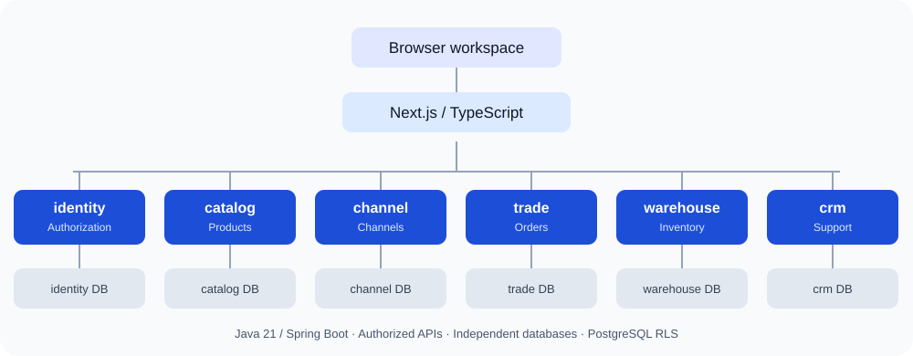

[**English**](README.md) | [简体中文](README.zh-CN.md)

<div align="center">


# starcon

### Bring products, orders, and inventory together for cross-border commerce.

A SaaS ERP for multi-platform businesses · Java microservices · Tenant data isolation

[](LICENSE)
[](backend/pom.xml)
[](apps/web/package.json)
[](apps/web/tsconfig.json)

[Quick start](#quick-start) · [Highlights](#highlights) · [Project status](#project-status) · [Architecture](#architecture) · [License](#license)

</div>

---

## Why starcon

Cross-border commerce spans marketplace dashboards, product spreadsheets, warehouse systems, and settlement reports. Product identifiers differ between platforms, orders and inventory become difficult to reconcile, and growing teams need clear permissions and data boundaries.

**starcon aims to provide a shared business foundation for products, channels, orders, inventory, fulfillment, and finance**: consistent product records, traceable inventory movements, explicit authorization, and well-defined service ownership.

Target business scenarios include Amazon, Shopify, eBay, TikTok Shop, and 1688. These names describe the intended scope; actual adapter readiness and live connectivity must be verified against implementation and acceptance records.

## Highlights

- **Product models built for variation.** SPU (product family) and SKU records support variant combinations, inherited attributes, and explicit overrides, with modules for brands, units, bundle BOMs, and product content.
- **Data isolation enforced in PostgreSQL.** Tenant context comes from authenticated membership. Row-Level Security, role permissions, and data scopes protect business records. Parent-child tenant relationships do not automatically grant access.
- **Traceable warehouse operations.** Inventory balances, reservations, receipts, putaway, picking, packing, and shipment handovers have dedicated models. Transactions, constraints, and tests validate important state and quantity changes.
- **Services organized around business ownership.** Java 21 and Spring Boot services own their databases and migrations. Cross-domain collaboration uses authorized APIs or events rather than shared business tables.
- **Contracts connect backend and frontend.** Backend OpenAPI definitions generate TypeScript contracts, supported by PostgreSQL integration tests, frontend unit tests, and browser tests.
- **Delivery evidence lives with the code.** A four-level blueprint covering 18 systems, architecture decisions, module status, and acceptance records let reviewers trace requirements to implementation.

## Project status

> Active development. This overview reflects **main as reviewed on October 15, 2026**; it does not claim full product completion or production readiness.

The [delivery ledger](docs/product/capability-blueprint/module-progress.md) lists **465 planned modules, with 152 marked delivered (32.7%)**. Modules are L4 capability units; this percentage measures blueprint coverage, not production maturity. Development branches may contain additional work that has not yet reached main.

| Area                      | Implementation on main                                                                                             | Next steps                                                             |
| ------------------------- | ------------------------------------------------------------------------------------------------------------------ | ---------------------------------------------------------------------- |
| Identity and organization | Local login, members, roles, departments, child tenants, page permissions, and data scopes                         | Production identity integration and deployment hardening               |
| Products and master data  | SPU/SKU, attributes, variants, brands, units, BOMs, content, and business-party modules                            | Product data governance and cross-domain integration                   |
| Channels and shops        | Connection records, mappings, sync tasks, and write-back management                                                | Platform-specific adapters and live API acceptance                     |
| Inventory and warehousing | Inventory ledger, reservations, receipts, putaway, transfers, stocktakes, picking, packing, and shipment handovers | More warehouse workflows and end-to-end acceptance                     |
| Orders and fulfillment    | Manual and B2B orders, order changes/cancellation, routing, pending shipments, and dropshipping modules            | Platform order ingestion and fulfillment coordination                  |
| Support and finance       | CRM knowledge-base service and some foundational configuration                                                     | Support workflows, multi-currency settlement, and financial accounting |

A page, configuration record, or task endpoint does not establish a working external integration. Consult the [capability blueprint](docs/product/capability-blueprint/README.md), [delivery ledger](docs/product/capability-blueprint/module-progress.md), and [acceptance records](docs/sessions/2026-10/) for scope and evidence. Most detailed project documentation is currently in Chinese.

## Quick start

### Requirements

- **Node.js ≥ 22.12.0** and **pnpm 9**; the repository pins `pnpm@9.0.0`.
- Docker Desktop, or Docker Engine with Compose, for PostgreSQL and backend services.
- **JDK 21** only when building the backend directly on the host; container startup includes its Java toolchain.

### Run locally

```bash
git clone https://github.com/sugar-hit/starcon.git
cd starcon
nvm install
nvm use
corepack enable
pnpm install

# Build and start PostgreSQL and backend services
pnpm dev:backend

# Start the frontend and keep this terminal running
pnpm --filter @starcon/web dev
```

Open [http://localhost:3000/products](http://localhost:3000/products). The first backend build downloads dependencies; allow the services to become ready before signing in.

First startup generates `deploy/.env.catalog.local`. Sign in as `local-admin` using the file's `LOCAL_ADMIN_PASSWORD` value. Keep this file private and out of version control. Bootstrap creates a development tenant and an Owner member; it does not populate demo products. See the [local development guide](docs/operations/catalog-local-development.md) for details.

| Service    | Local port | Responsibility                            |
| ---------- | ---------- | ----------------------------------------- |
| Web        | 3000       | Browser workspace                         |
| identity   | 8081       | Identity, organization, and authorization |
| catalog    | 8082       | Products and master data                  |
| channel    | 8083       | Channels and shops                        |
| warehouse  | 8084       | Inventory and warehouse operations        |
| PostgreSQL | 5433       | Separate databases for each service       |
| trade      | 8085       | Orders and fulfillment                    |
| crm        | 8086       | Support knowledge base                    |

Port bindings are defined in [`docker-compose.catalog.yml`](deploy/docker/docker-compose.catalog.yml).

### Suggested demonstration

1. **Build a product record:** create an SPU, define attributes and variant axes, add SKUs, and demonstrate inherited values and overrides.
2. **Show permission boundaries:** configure roles and members, test restricted visibility, and demonstrate independent parent and child tenant data boundaries.
3. **Explore warehouse operations:** prepare warehouse, location, and inventory data, then demonstrate implemented receipt, putaway, reservation, picking, and packing pages.
4. **Trace business records:** inspect pending shipments, parcels, and handover records to explain how quantity changes relate to business events.

The warehouse steps require upstream records and permissions. Page prerequisites and limitations are documented in the acceptance records linked from the [delivery ledger](docs/product/capability-blueprint/module-progress.md).

## Architecture



The diagram shows current services and database ownership. Business services also verify identity and permissions through authorized interfaces; they do not access another service's database directly. See [ADR-0004](docs/decisions/0004-java-spring-boot-microservices.md) for service boundaries. Finance and other domains expand this architecture as implementation progresses.

| Layer        | Technology                                                      |
| ------------ | --------------------------------------------------------------- |
| Frontend     | Next.js 15, React 18, strict TypeScript, Tailwind CSS, Radix UI |
| Backend      | Java 21, Spring Boot, Maven Wrapper, jOOQ                       |
| Data         | PostgreSQL 16, Flyway SQL migrations, Row-Level Security        |
| Contracts    | SpringDoc OpenAPI, TypeScript generation                        |
| Verification | Vitest, Playwright, JUnit 5, AssertJ, Testcontainers PostgreSQL |
| Engineering  | pnpm workspaces, Turborepo, Docker Compose, GitHub Actions      |

Cloud deployment and event delivery evolve in stages. Planned infrastructure and messaging components are not presented as current runtime requirements.

## Repository layout

```text
starcon/
├── apps/web/              # Next.js client
├── backend/
│   ├── services/          # identity / catalog / channel / trade / warehouse / crm
│   └── libraries/         # Shared technical capabilities, including tenancy
├── packages/              # UI, configuration, and generated frontend contracts
├── db/schemas/            # Data design; executable Flyway migrations live in services
├── deploy/                # Containers and local startup/test scripts
├── tests/                 # Cross-module, contract, and browser tests
├── tools/                 # Code generation and delivery tracking
└── docs/                  # Blueprint, decisions, design, and acceptance evidence
```

## Development and verification

```bash
pnpm lint
pnpm typecheck
pnpm test                    # Frontend unit tests
pnpm build                   # Frontend and shared-package build
pnpm test:backend            # Java 21 + PostgreSQL integration tests in Docker
pnpm test:e2e                # Prepare services required by the browser test configuration
pnpm progress:check          # Check blueprint/ledger synchronization
```

With JDK 21 on the host, run `./mvnw verify` from `backend/`. Add new Flyway migrations for database changes. Generate frontend contracts from backend OpenAPI rather than editing generated files.

## Documentation

| Topic                              | Entry point                                                                                                                                   |
| ---------------------------------- | --------------------------------------------------------------------------------------------------------------------------------------------- |
| Product scope and roadmap          | [18-system capability blueprint](docs/product/capability-blueprint/README.md)                                                                 |
| Delivery status and evidence       | [Module ledger](docs/product/capability-blueprint/module-progress.md)                                                                         |
| Service boundaries and decisions   | [Architecture](docs/architecture/overview.md) · [ADRs](docs/decisions/README.md)                                                              |
| Tenant isolation and authorization | [Multi-tenancy](docs/architecture/multi-tenancy.md) · [Tenant hierarchy and page RBAC](docs/decisions/0005-tenant-hierarchy-and-page-rbac.md) |
| Local development                  | [Development guide](docs/operations/catalog-local-development.md)                                                                             |
| Interface design                   | [Visual specification](docs/design/visual-spec.md)                                                                                            |
| Contributing                       | [Contribution guide](CONTRIBUTING.md) · [Agent instructions](AGENTS.md)                                                                       |
| Usage and commercial authorization | [Licensing guide](LICENSING.md) · [License text](LICENSE)                                                                                     |

## License

**Source is available for permitted noncommercial use, learning, research, modification, and sharing. Commercial use outside the license's permitted purposes requires separate prior written authorization from the relevant rights holders.**

starcon uses the [PolyForm Noncommercial License 1.0.0](LICENSE), SPDX identifier `PolyForm-Noncommercial-1.0.0`. Because commercial use is restricted, this is **source-available software**, not open source under the OSI definition.

Public access and fork permissions do not grant commercial rights for business operations, commercial SaaS, derivative product sales, or commercial delivery. Contact the maintainer through the [GitHub profile](https://github.com/sugar-hit), or submit a licensing inquiry without sensitive information in [Issues](https://github.com/sugar-hit/starcon/issues). An inquiry is not authorization.

The full rights, obligations, and express exceptions are governed by [`LICENSE`](LICENSE). See [`LICENSING.md`](LICENSING.md) for English and Chinese guidance, third-party materials, and the authorization process. Preserve the license and the Required Notices in [`NOTICE`](NOTICE) when distributing copies.
