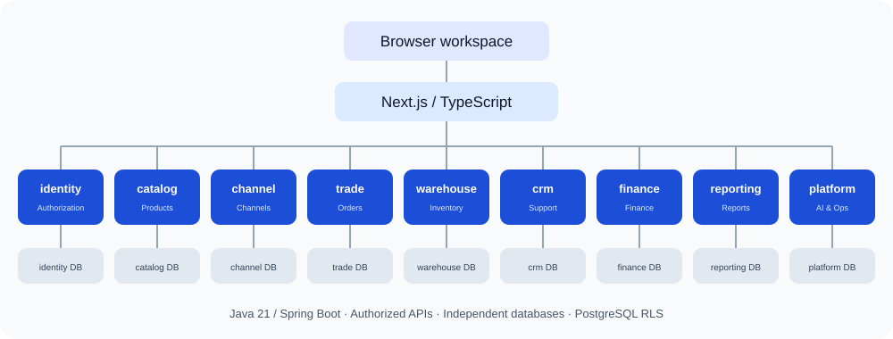

[**English**](README.md) | [简体中文](README.zh-CN.md)

<div align="center">

<picture>
  <source media="(prefers-color-scheme: dark)" srcset="apps/web/public/logo-app-icon-light.svg">
  <source media="(prefers-color-scheme: light)" srcset="apps/web/public/logo-app-icon-dark.svg">
  
</picture>

# starcon

### The shared operating system for cross-border commerce.

One tenant-isolated business foundation for products, channels, orders, inventory, fulfillment, finance, growth, and service.

[](LICENSE)
[](backend/pom.xml)
[](backend/pom.xml)
[](apps/web/package.json)
[](apps/web/tsconfig.json)
[](deploy/docker/docker-compose.catalog.yml)

[Why starcon](#why-starcon) · [Highlights](#highlights) · [Project status](#project-status) · [Quick start](#quick-start) · [Architecture](#architecture) · [License](#license)

</div>

---

## Why starcon

Running a cross-border business means running a stack of systems that never quite agree: marketplace dashboards, product spreadsheets, the warehouse system, settlement statements, advertising consoles, and support queues. The same product carries a different identifier on every platform, orders and stock drift apart, and once the team grows, nobody can say who is allowed to see which customer's data.

starcon replaces that patchwork with one business foundation. Product records have a single home, every inventory movement leaves a trace, every operation is bound to an explicit permission, and every domain owns exactly one set of facts. Cross-platform work stops being reconciliation and starts being routine.

The product targets Amazon, Shopify, eBay, TikTok Shop, Temu, Lazada, Shopee, and Walmart. Their OAuth authorization adapters are implemented in the channel service; the live business APIs — order ingestion, listing sync, advertising data — are still to be verified against acceptance records.

## Highlights

- **One product backbone across the chain.** SPU and SKU records carry variant axes, inherited attributes, and explicit overrides. Brands, units, bundle BOMs, and product content live next to listings, pricing, and purchase records instead of in a parallel spreadsheet.
- **Isolation enforced by the database, not by convention.** Tenant context is resolved from authenticated membership. Business tables carry `tenant_id NOT NULL` under row-level security, and page permissions and data scopes are granted together, in the same role. A parent tenant never inherits a child's data by accident.
- **Nine services, one owner per fact.** identity, catalog, channel, trade, warehouse, crm, finance, reporting, and platform each own their database and their Flyway migrations. Domains collaborate through authorized APIs and events — no cross-service SQL, no foreign keys across databases, no shared views.
- **The blueprint is fully covered.** All 465 L4 modules across 18 business systems are recorded in the delivery ledger, each with the migration, API, page, and test that prove it.
- **Finance and analytics are built in, not bolted on.** Receivables and payables, payments, vouchers, reconciliation, costing, deferred settlement, profit reports, custom dashboards, and SKU-level profit — with `BigDecimal` money over `NUMERIC` columns, from API to ledger.
- **Automation and AI belong to the platform.** Smart query, AI diagnosis and forecasting, automation rules with measured effect, an API gateway, event subscriptions, and external integrations are first-class services, not scripts hung on a page.
- **Contracts keep both sides honest.** Backend OpenAPI generates the TypeScript contracts. CI runs PostgreSQL integration tests per service alongside frontend unit tests, browser tests, and a blueprint-to-ledger consistency check.
- **The evidence lives with the code.** A four-level blueprint, the architecture decision records, the module ledger, and per-session acceptance records let a reviewer trace a requirement all the way to its implementation.

## Project status

> Active development. This overview reflects `main` as reviewed on **November 5, 2026**. It describes what the repository contains — not a production-readiness claim.

The [delivery ledger](docs/product/capability-blueprint/module-progress.md) records **465 planned modules, all 465 marked delivered (100.0%)**. A module counts as delivered only when its migration, API, page, and tests are all in place, so this number measures blueprint coverage — not production maturity, and not live connectivity to any marketplace. `pnpm progress:check` keeps the ledger and the blueprint from drifting apart.

| Area                              | Volumes | Modules | Implementation on main                                                                                     | Next steps                                          |
| --------------------------------- | ------- | ------- | ---------------------------------------------------------------------------------------------------------- | --------------------------------------------------- |
| Workbench and portal              | 01      | 23      | Role-aware workbench, to-do intake, metric cards, store overview, personal settings                        | Metric definitions and live refresh                 |
| Channels and shops                | 02      | 25      | Shop connections, platform OAuth adapters, listing mappings, sync tasks, write-back                        | Live platform API acceptance                        |
| Product master data               | 03      | 40      | SPU/SKU, attributes, variants, brands, units, BOMs, content, business partners                             | Product data governance                             |
| Listings and content              | 04      | 26      | Listing editor, category mappings, keywords, lifecycle, publish tasks, content write-back                  | Real listing publication and platform sync          |
| Pricing                           | 05      | 19      | Price strategies, price lists, exchange rates, batch maintenance, conflict detection                       | Live platform repricing                             |
| Purchase and supply               | 06      | 26      | Purchase orders, arrivals, demand planning, supplier qualification and ratings                             | Supplier settlement integration                     |
| Inventory and warehousing         | 07, 08  | 53      | Inventory ledger, reservations, receipts, putaway, transfers, stocktakes, picking, packing, handovers      | Multi-warehouse ownership and end-to-end acceptance |
| Orders, logistics, and aftersales | 09–11   | 76      | Order aggregation, changes and cancellation, routing, pending shipments, freight, customs, returns         | Platform order ingestion                            |
| Finance and profit                | 12, 13  | 55      | Receivables/payables, payments, vouchers, reconciliation, costing, settlement, profit and custom reports   | Deferred multi-currency settlement                  |
| Ads and growth                    | 14      | 22      | Campaigns, budgets, bidding, attribution, promotions, influencer outreach, ad diagnostics                  | Platform advertising API                            |
| CRM and service                   | 15      | 24      | Customer profiles, lifecycle, membership levels, points, reviews, service tickets, auto-replies            | Omnichannel conversation intake                     |
| Compliance and risk               | 16      | 23      | Linkage and IP risk, buyer blacklists, platform violations and appeals, EPR/VAT and data retention         | Rule operations and external compliance services    |
| Organization and permissions      | 17      | 29      | Members, roles, page permissions, data scopes, departments, child tenants, approval rules                  | Production identity provider integration            |
| Integration and automation        | 18      | 24      | Smart query, AI diagnosis and forecast, automation rules, API gateway, event subscriptions, effect reports | Model and external system acceptance                |

A page, a configuration record, or a task endpoint does not establish a working external integration. For scope and evidence, read the [capability blueprint](docs/product/capability-blueprint/README.md), the [delivery ledger](docs/product/capability-blueprint/module-progress.md), and the [acceptance records](docs/sessions/2026-11/). Most of the detailed project documentation is in Chinese.

## Quick start

### Requirements

- **Node.js ≥ 22.12.0** and **pnpm 9** — the repository pins `pnpm@9.0.0`.
- Docker Desktop, or Docker Engine with Compose, for PostgreSQL and the backend services.
- **JDK 21**, and only when you build the backend directly on the host. The container images carry their own Java toolchain.

### Run it locally

```bash
git clone https://github.com/sugar-hit/starcon.git
cd starcon
nvm install
nvm use
corepack enable
pnpm install

# Build and start PostgreSQL and the nine backend services
pnpm dev:backend

# Start the frontend and keep this terminal running
pnpm --filter @starcon/web dev
```

Open [http://localhost:3000/products](http://localhost:3000/products). The first backend build downloads its dependencies, so give the services a moment to become ready before signing in.

The first start generates `deploy/.env.catalog.local`. Sign in as `local-admin` with the `LOCAL_ADMIN_PASSWORD` value from that file, and keep the file private and out of version control. Bootstrap creates a development tenant and an Owner member — it does not seed demo products. Details live in the [local development guide](docs/operations/catalog-local-development.md).

| Service    | Local port | Responsibility                            |
| ---------- | ---------- | ----------------------------------------- |
| Web        | 3000       | Browser workspace                         |
| identity   | 8081       | Identity, organization, and authorization |
| catalog    | 8082       | Products and master data                  |
| channel    | 8083       | Channels, shops, and listings             |
| warehouse  | 8084       | Inventory and warehouse operations        |
| trade      | 8085       | Orders, logistics, and aftersales         |
| crm        | 8086       | Customers and service                     |
| finance    | 8087       | Accounting, settlement, and costing       |
| reporting  | 8088       | Dashboards, analytics, and exports        |
| platform   | 8089       | Automation, AI, and open integration      |
| PostgreSQL | 5433       | Separate databases for each service       |

Port bindings are defined in [`docker-compose.catalog.yml`](deploy/docker/docker-compose.catalog.yml).

### A tour worth taking

1. **Start at the workbench** — to-do intake, metric cards, and the store overview give you the shape of the business.
2. **Build a product record** — create an SPU, define attributes and variant axes, add SKUs, and watch values inherit and override.
3. **Draw a permission boundary** — configure roles and members, verify restricted visibility, and show a child tenant that cannot see its parent.
4. **Follow the physical chain** — from reservation to picking, packing, and shipment handover, and on into a return.
5. **Close the financial loop** — read the vouchers, reconciliation tasks, and settlement that the profit report is built on.
6. **Try the automation layer** — run a smart query, an AI diagnosis, and an automation rule, then read its effect report.

Steps four to six need upstream records and the right permissions. The acceptance records linked from the [delivery ledger](docs/product/capability-blueprint/module-progress.md) list each page's prerequisites and current limits.

## Architecture



The diagram shows the current services and who owns which data. Business services also verify identity and permissions through authorized interfaces; they never reach into another service's database. See [ADR-0004](docs/decisions/0004-java-spring-boot-microservices.md) for the service boundaries and the [architecture overview](docs/architecture/overview.md) for the wider picture.

| Layer        | Technology                                                      |
| ------------ | --------------------------------------------------------------- |
| Frontend     | Next.js 15, React 18, strict TypeScript, Tailwind CSS, Radix UI |
| Backend      | Java 21, Spring Boot, Maven Wrapper, jOOQ                       |
| Data         | PostgreSQL 16, Flyway SQL migrations, Row-Level Security        |
| Contracts    | SpringDoc OpenAPI, TypeScript generation                        |
| Verification | Vitest, Playwright, JUnit 5, AssertJ, Testcontainers PostgreSQL |
| Engineering  | pnpm workspaces, Turborepo, Docker Compose, GitHub Actions      |

Cloud deployment and event delivery advance in stages. Planned infrastructure and messaging components are not presented as current runtime requirements.

## Repository layout

```text
starcon/
├── apps/
│   ├── web/                 # Next.js workspace (the implemented frontend)
│   └── admin/ api/ worker/ scheduler/ notification-gateway/   # scaffolding only
├── backend/
│   ├── services/            # identity / catalog / channel / trade / warehouse /
│   │                       # crm / finance / reporting / platform
│   └── libraries/           # Shared technical capabilities, including tenancy
├── packages/                # Shared frontend libraries: ui (design system) and
│                            # api-contracts (generated) carry the implementation;
│                            # tenancy / money / observability / i18n / ... are scaffolding
├── services/                # Heterogeneous services (OCR, data pipeline) — scaffolding
├── workers/                 # Standalone workers (marketplace sync, mail, reports) — scaffolding
├── db/schemas/              # Data design; executable Flyway migrations live in services
├── deploy/                  # Container images, Compose, local startup and test scripts
├── infra/                   # Terraform / Helm / Kubernetes / ArgoCD — scaffolding
├── tests/                   # Cross-module, contract, integration, load, browser tests
├── tools/                   # Internal CLI, contract codegen, ledger synchronization
└── docs/                    # Blueprint, decisions, design, compliance, acceptance records
```

## Development and verification

```bash
pnpm lint
pnpm typecheck
pnpm test                    # Frontend unit tests
pnpm build                   # Frontend and shared-package build
pnpm test:backend            # Java 21 + PostgreSQL integration tests in Docker
pnpm test:e2e                # Prepare the services the browser test configuration needs
pnpm contracts:generate      # Regenerate the TypeScript contracts from backend OpenAPI
pnpm db:migrate              # Apply each service's Flyway migrations
pnpm db:generate             # Generate jOOQ code from a migrated database
pnpm progress:check          # Check blueprint/ledger synchronization
```

With JDK 21 on the host, run `./mvnw verify` from `backend/`. Database changes travel as new Flyway migrations. Frontend contracts are generated from backend OpenAPI — never hand-edited.

## Documentation

| Topic                              | Entry point                                                                                                                                   |
| ---------------------------------- | --------------------------------------------------------------------------------------------------------------------------------------------- |
| Product scope and roadmap          | [18-system capability blueprint](docs/product/capability-blueprint/README.md)                                                                 |
| Delivery status and evidence       | [Module ledger](docs/product/capability-blueprint/module-progress.md)                                                                         |
| Service boundaries and decisions   | [Architecture](docs/architecture/overview.md) · [ADRs](docs/decisions/README.md)                                                              |
| Tenant isolation and authorization | [Multi-tenancy](docs/architecture/multi-tenancy.md) · [Tenant hierarchy and page RBAC](docs/decisions/0005-tenant-hierarchy-and-page-rbac.md) |
| Local development                  | [Development guide](docs/operations/catalog-local-development.md)                                                                             |
| Interface design                   | [Visual specification](docs/design/visual-spec.md)                                                                                            |
| Acceptance records                 | [Session archive](docs/sessions/README.md)                                                                                                    |
| Contributing                       | [Contribution guide](CONTRIBUTING.md) · [Agent instructions](AGENTS.md)                                                                       |
| Usage and commercial authorization | [Licensing guide](LICENSING.md) · [License text](LICENSE)                                                                                     |

## License

**Source is available for permitted noncommercial use, learning, research, modification, and sharing. Commercial use outside the license's permitted purposes requires separate prior written authorization from the relevant rights holders.**

starcon uses the [PolyForm Noncommercial License 1.0.0](LICENSE), SPDX identifier `PolyForm-Noncommercial-1.0.0`. Because commercial use is restricted, this is **source-available software**, not open source under the OSI definition.

Public access and fork permissions do not grant commercial rights for business operations, commercial SaaS, derivative product sales, or commercial delivery. Contact the maintainer through the [GitHub profile](https://github.com/sugar-hit), or submit a licensing inquiry without sensitive information in [Issues](https://github.com/sugar-hit/starcon/issues). An inquiry is not authorization.

The full rights, obligations, and express exceptions are governed by [`LICENSE`](LICENSE). See [`LICENSING.md`](LICENSING.md) for English and Chinese guidance, third-party materials, and the authorization process. Preserve the license and the Required Notices in [`NOTICE`](NOTICE) when distributing copies.

---

<sub>Last reviewed against `main` on **2026-11-05** · <a href="https://github.com/sugar-hit/starcon/commits/main">commit history</a> · <a href="https://github.com/sugar-hit/starcon/graphs/contributors">contributors</a> · <a href="https://github.com/sugar-hit/starcon/issues">issues</a></sub>
