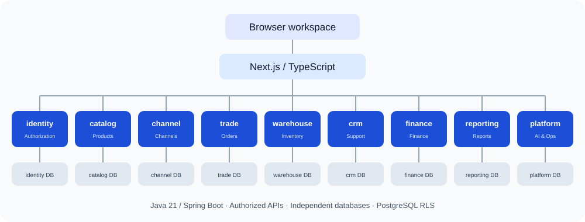

[English](README.md) | **简体中文**

<div align="center">


# starcon

### 让跨境电商的商品、订单与库存，在同一个业务系统中协同。

面向多平台经营企业的 SaaS ERP · 9 个 Java 微服务 · PostgreSQL 行级安全

[](LICENSE)
[](backend/pom.xml)
[](apps/web/package.json)
[](apps/web/tsconfig.json)

[快速体验](#快速体验) · [项目亮点](#项目亮点) · [实现进度](#实现进度) · [系统架构](#系统架构) · [使用许可](#使用许可)

</div>

---

## 为什么做 starcon

跨境电商的业务分散在店铺后台、商品资料表、仓库系统、结算报表、广告后台与客服工单里。同一个 SKU 在不同平台的标识不一致，订单与库存难以协同，组织扩张后又会遇到权限和数据隔离问题。

**starcon 希望建立一套贯穿商品、渠道、订单、库存、履约、财务、增长与客服的业务底座**：商品有统一档案，库存变化有可追溯流水，业务操作有明确权限，跨服务协作有清晰边界。

项目面向 Amazon、Shopify、eBay、TikTok Shop、Temu、Lazada、Shopee、Walmart 等多平台经营场景。渠道服务已实现上述平台的 OAuth 授权适配器；订单接入、刊登同步、广告数据等实网业务接口仍需按验收记录逐项确认。

## 项目亮点

- **一条商品主线贯穿全链路**：SPU / SKU 支持规格组合、属性继承与覆写，品牌、单位、套装 BOM 与商品资料和刊登、定价、采购记录同源管理。
- **把数据隔离落实到数据库**：认证成员关系解析租户，业务表使用 `tenant_id NOT NULL` 与 PostgreSQL RLS；角色操作权限和数据范围共同决定访问边界，父子租户关系不自动授予业务访问权。
- **九个服务，一张事实表只有一个主人**：identity、catalog、channel、trade、warehouse、crm、finance、reporting、platform 各自拥有数据库与 Flyway 迁移；跨域协作走授权 API 或事件，不做跨服务 SQL、跨库外键或共享视图。
- **功能蓝图已全覆盖**：18 个业务系统、465 个 L4 模块，每个模块在交付台账里都对应迁移、接口、页面与测试证据。
- **财务与分析是一等公民**：应收应付、收付款、凭证、对账、成本、递延结算、利润报表、自定义看板与 SKU 级利润，金额一律 `BigDecimal` 落到 `NUMERIC` 列。
- **自动化与 AI 长在平台服务里**：智能查询、AI 诊断与预测、带效果评估的自动化规则、API 网关、事件订阅与外部集成。
- **前后端围绕契约协作**：后端 OpenAPI 生成 TypeScript 契约；CI 按服务跑 PostgreSQL 集成测试，再叠加前端单元测试、浏览器测试与蓝图台账一致性校验。
- **设计与交付证据可追溯**：四级功能蓝图、架构决策、模块进度台账和会话验收记录均保存在仓库中，方便评审从需求追踪到实现。

## 实现进度

> 项目处于持续开发阶段。以下为 main 分支截至 **2026-11-04** 的实现概览，不代表全部功能已完成或已经生产上线。

[交付台账](docs/product/capability-blueprint/module-progress.md)记录了 **465 个规划模块，465 个全部标记为已交付（100.0%）**。这里的模块是蓝图中的 L4 功能单元，只有迁移、接口、页面、测试四件齐全才算「已交付」——所以这个百分比衡量的是蓝图覆盖度，不是生产成熟度，也不是平台实网连通性。`pnpm progress:check` 负责保证台账与蓝图不漂移。

| 领域                 | 卷    | 模块数 | 当前已有实现                                                       | 继续推进的方向              |
| -------------------- | ----- | ------ | ------------------------------------------------------------------ | --------------------------- |
| 工作台与门户         | 01    | 23     | 角色化工作台、待办入口、指标卡、店铺概览、个人设置                 | 指标口径与实时刷新          |
| 渠道与店铺           | 02    | 25     | 店铺连接、平台 OAuth 授权适配器、刊登映射、同步任务与回写管理      | 实网 API 验收与真实刊登发布 |
| 商品主数据           | 03    | 40     | SPU / SKU、属性、规格、品牌、单位、BOM、资料及往来方相关模块       | 商品资料治理                |
| 刊登与内容           | 04    | 26     | 刊登编辑器、类目映射、关键词、生命周期、发布任务、内容回写         | 真实刊登发布与平台同步      |
| 定价与价目           | 05    | 19     | 价格策略、价目表、汇率、批量维护与优先级冲突检测                   | 平台实时调价                |
| 采购与供应           | 06    | 26     | 采购单、到货、需求计划、供应商资质与评分                           | 供应商结算联动              |
| 库存与仓储           | 07–08 | 53     | 库存台账、预占、收货上架、调拨、盘点、拣货、打包与发货交接         | 多仓货权与全链路验收        |
| 订单、物流与售后     | 09–11 | 76     | 订单聚合、变更取消、履约路由、待发货、运费与头程、报关、退货与纠纷 | 平台订单实网接入            |
| 财务与利润           | 12–13 | 55     | 应收应付、收付款、凭证、对账、成本、结算、利润与自定义报表         | 多币种递延结算与正式报表    |
| 广告与增长           | 14    | 22     | 广告活动、预算、竞价、归因、促销、达人建联与投放诊断               | 平台广告实网接口            |
| 客户与客服           | 15    | 24     | 客户档案、生命周期、会员等级、积分、评价、服务工单与自动回复       | 全渠道会话接入              |
| 合规与风控           | 16    | 23     | 关联与 IP 风控、买家黑名单、平台违规与申诉、EPR/VAT 税务、数据留存 | 规则运营与外部合规服务接入  |
| 组织权限与系统设置   | 17    | 29     | 成员、角色、页面权限、数据范围、部门、子租户与审批规则             | 正式身份提供方接入          |
| 集成开放与智能自动化 | 18    | 24     | 智能查询、AI 诊断与预测、自动化规则、API 网关、事件订阅与效果评估  | 模型与外部系统实网验收      |

页面入口、演示数据、配置记录或任务接口的存在，不等于外部平台已完成真实连接。详细范围和证据请查看[功能蓝图](docs/product/capability-blueprint/README.md)、[交付台账](docs/product/capability-blueprint/module-progress.md)与[会话验收记录](docs/sessions/2026-11/)。

## 快速体验

### 环境要求

- Node.js **≥ 22.12.0**，pnpm **9**（仓库固定 `pnpm@9.0.0`）。
- Docker Desktop 或可用的 Docker Engine + Compose，用于运行 PostgreSQL 和后端服务。
- 仅在宿主机直接构建后端时需要 **JDK 21**；容器启动方式自带 Java 工具链。

### 启动

```bash
git clone https://github.com/sugar-hit/starcon.git
cd starcon
nvm install
nvm use
corepack enable
pnpm install

# 构建并启动 PostgreSQL 与九个后端服务
pnpm dev:backend

# 启动前端（保持此终端运行）
pnpm --filter @starcon/web dev
```

打开 [http://localhost:3000/products](http://localhost:3000/products)。首次后端构建需要下载依赖，服务启动后请等待接口就绪。

首次启动会自动生成 `deploy/.env.catalog.local`。本地账号为 `local-admin`，密码读取该文件的 `LOCAL_ADMIN_PASSWORD`；不要提交或公开此文件。初次引导创建开发租户和 Owner 成员，不自动填充演示商品。详细说明见[本地开发指南](docs/operations/catalog-local-development.md)。

| 服务       | 本地端口 | 职责                  |
| ---------- | -------- | --------------------- |
| Web        | 3000     | 浏览器工作区          |
| identity   | 8081     | 身份、组织与权限      |
| catalog    | 8082     | 商品与主数据          |
| channel    | 8083     | 渠道、店铺与刊登      |
| warehouse  | 8084     | 库存与仓储作业        |
| trade      | 8085     | 订单、物流与售后      |
| crm        | 8086     | 客户与客服            |
| finance    | 8087     | 核算、结算与成本      |
| reporting  | 8088     | 看板、分析与导出      |
| platform   | 8089     | 自动化、AI 与开放集成 |
| PostgreSQL | 5433     | 各服务的独立数据库    |

服务端口绑定配置以 [`docker-compose.catalog.yml`](deploy/docker/docker-compose.catalog.yml) 为准。

### 建议演示路线

1. **从工作台开始**：看待办入口、指标卡与店铺概览，建立整体感。
2. **商品建档**：登录商品中心，创建 SPU、配置属性与规格，再建立 SKU，展示公共值继承与独立覆写。
3. **组织权限**：创建角色和成员，配置页面操作与数据范围，使用受限成员验证可见范围；展示父子租户的独立数据边界。
4. **串起作业与履约**：从库存预占走到拣货、打包与发货交接，再看订单进入售后流程。
5. **闭环到财务**：查看凭证、对账任务与结算记录，再读基于这些数据的利润报表。
6. **试用自动化层**：跑一次智能查询、一次 AI 诊断，再执行一条自动化规则并查看效果评估。

后三步需要先准备上游业务数据和权限。具体页面的前置条件及当前限制见[模块台账](docs/product/capability-blueprint/module-progress.md)所链接的验收记录。

## 系统架构



图中展示当前服务与数据所有权。业务服务还通过授权接口核验身份和权限；跨服务调用不直接读写对方数据库。完整边界见 [ADR-0004](docs/decisions/0004-java-spring-boot-microservices.md)，更完整的视图见[架构总览](docs/architecture/overview.md)。

| 层次 | 技术选择                                                          |
| ---- | ----------------------------------------------------------------- |
| 前端 | Next.js 15、React 18、TypeScript 严格模式、Tailwind CSS、Radix UI |
| 后端 | Java 21、Spring Boot、Maven Wrapper、jOOQ                         |
| 数据 | PostgreSQL 16、Flyway SQL 迁移、Row-Level Security                |
| 契约 | SpringDoc OpenAPI、TypeScript 代码生成                            |
| 验证 | Vitest、Playwright、JUnit 5、AssertJ、Testcontainers PostgreSQL   |
| 工程 | pnpm workspaces、Turborepo、Docker Compose、GitHub Actions        |

云原生部署和事件协作按阶段推进；不将规划中的中间件或基础设施视为当前运行依赖。

## 仓库结构

```text
starcon/
├── apps/
│   ├── web/                 # Next.js 工作区（当前已实现的前端）
│   └── admin/ api/ worker/ scheduler/ notification-gateway/   # 仅有脚手架
├── backend/
│   ├── services/            # identity / catalog / channel / trade / warehouse /
│   │                       # crm / finance / reporting / platform
│   └── libraries/           # 租户、安全等共享技术能力
├── packages/                # 前端共享库：ui（设计系统）与 api-contracts（生成物）
│                            # 已落地，tenancy / money / observability / i18n / ... 仍为占位
├── services/                # 异构服务（OCR、数据管道）—— 仅有脚手架
├── workers/                 # 独立 worker（平台同步、发信、报表）—— 仅有脚手架
├── db/schemas/              # 数据模型设计；可执行迁移以各服务 Flyway 为准
├── deploy/                  # 容器镜像、Compose、本地启动与测试脚本
├── infra/                   # Terraform / Helm / K8s / ArgoCD —— 仅有脚手架
├── tests/                   # 跨模块、契约、集成、压测与浏览器测试
├── tools/                   # 内部 CLI、契约代码生成、台账同步
└── docs/                    # 蓝图、决策、设计、合规与验收记录
```

## 开发与验证

```bash
pnpm lint
pnpm typecheck
pnpm test                    # 前端单元测试
pnpm build                   # 前端与共享包构建
pnpm test:backend            # Docker 内 Java 21 + PostgreSQL 集成测试
pnpm test:e2e                # 浏览器测试；按测试配置准备运行服务
pnpm contracts:generate      # 由后端 OpenAPI 重新生成前端契约
pnpm db:migrate              # 执行各服务的 Flyway 迁移
pnpm db:generate             # 从已迁移数据库生成 jOOQ 代码
pnpm progress:check          # 校验蓝图与台账同步
```

宿主机使用 JDK 21 时，可在 `backend/` 执行 `./mvnw verify`。数据库变更使用新增 Flyway 迁移；前端契约由后端 OpenAPI 生成，不手工修改生成物。

## 文档导航

| 想了解什么           | 阅读入口                                                                                                                        |
| -------------------- | ------------------------------------------------------------------------------------------------------------------------------- |
| 产品覆盖范围与路线图 | [18 系统功能蓝图](docs/product/capability-blueprint/README.md)                                                                  |
| 哪些模块已完成       | [模块交付进度与证据](docs/product/capability-blueprint/module-progress.md)                                                      |
| 服务边界与技术决策   | [架构总览](docs/architecture/overview.md) · [ADR](docs/decisions/README.md)                                                     |
| 租户隔离与授权       | [多租户设计](docs/architecture/multi-tenancy.md) · [租户层级与页面 RBAC](docs/decisions/0005-tenant-hierarchy-and-page-rbac.md) |
| 本地运行与数据库操作 | [本地开发指南](docs/operations/catalog-local-development.md)                                                                    |
| 界面设计             | [视觉规范](docs/design/visual-spec.md)                                                                                          |
| 验收记录             | [会话归档](docs/sessions/README.md)                                                                                             |
| 如何参与             | [贡献指南](CONTRIBUTING.md) · [AI 协作规范](AGENTS.md)                                                                          |
| 使用与商业授权       | [许可说明](LICENSING.md) · [完整许可证](LICENSE)                                                                                |

## 使用许可

**源码公开，允许协议范围内的非商业体验、学习、研究、修改与分享；商业使用须事先取得相关权利人的单独书面授权。**

本项目采用 [PolyForm Noncommercial License 1.0.0](LICENSE)，SPDX 标识为 `PolyForm-Noncommercial-1.0.0`。限制商业用途的许可证属于 **source-available（源码可用）**，不属于 OSI 定义的开源许可证。

将本项目用于企业经营、收费 SaaS、销售衍生产品或商业交付等用途，不能仅凭仓库公开或 fork 权限取得商业许可。请通过[仓库维护者主页](https://github.com/sugar-hit)联系，或在 [Issues](https://github.com/sugar-hit/starcon/issues) 中提出不含敏感信息的授权咨询；咨询本身不构成授权。

完整权利、义务及标准协议中的例外以 [`LICENSE`](LICENSE) 为准；中英文说明、第三方素材与商业授权流程见 [`LICENSING.md`](LICENSING.md)。分发时须保留许可证和 [`NOTICE`](NOTICE) 中的 Required Notice。
