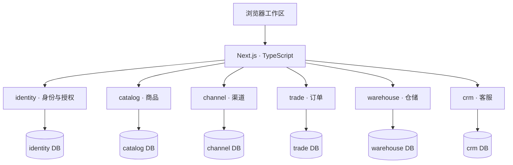

[English](README.md) | **简体中文**

<div align="center">

# starcon

### 让跨境电商的商品、订单与库存，在同一个业务系统中协同。

面向多平台经营企业的 SaaS ERP · Java 微服务 · 多租户数据隔离

[](LICENSE)
[](backend/pom.xml)
[](apps/web/package.json)
[](apps/web/tsconfig.json)

[快速体验](#快速体验) · [项目亮点](#项目亮点) · [实现进度](#实现进度) · [系统架构](#系统架构) · [使用许可](#使用许可)

</div>

---

## 为什么做 starcon

跨境电商的业务分散在店铺后台、商品资料表、仓库系统与结算报表中。同一个 SKU 在不同平台的标识不一致，订单与库存难以协同，组织扩张后又会遇到权限和数据隔离问题。

**starcon 希望建立一套贯穿商品、渠道、订单、库存、履约与财务的业务底座**：商品有统一档案，库存变化有可追溯流水，业务操作有明确权限，跨服务协作有清晰边界。

项目面向 Amazon、Shopify、eBay、TikTok Shop、1688 等多平台经营场景。平台名称代表目标业务覆盖范围；具体适配器与实网接入状态以对应实现和验收记录为准。

## 项目亮点

- **面向真实商品复杂度建模**：以 SPU / SKU 统一商品档案，支持规格组合、属性继承与覆写，并逐步扩展品牌、单位、套装 BOM 和商品资料管理。
- **把数据隔离落实到数据库**：认证成员关系解析租户，业务表使用 PostgreSQL RLS；角色操作权限和数据范围共同决定访问边界，父子租户关系不自动授予业务访问权。
- **围绕仓库作业组织履约**：库存余额、预占、收货、上架、拣货、打包与发货交接都有独立业务模型，关键状态转换和数量变化通过事务、约束与测试验证。
- **按领域拆分服务**：Java 21 + Spring Boot 微服务，每个服务拥有自己的数据库与迁移；跨域协作通过授权 API 或事件，避免共享业务表。
- **前后端围绕契约协作**：后端 OpenAPI 生成 TypeScript 契约，配合数据库集成测试、前端单元测试和浏览器测试，减少接口漂移。
- **设计与交付证据可追溯**：18 个系统的四级功能蓝图、架构决策、模块进度台账和会话验收记录均保存在仓库中，方便评审从需求追踪到实现。

## 实现进度

> 项目处于持续开发阶段。以下为main 分支截至 **2026-10-15** 的实现概览，不代表全部功能已完成或已经生产上线。

[交付台账](docs/product/capability-blueprint/module-progress.md)记录了 **465 个规划模块，其中 152 个标记为已交付（32.7%）**。这里的模块是蓝图中的 L4 功能单元，完成率不是生产成熟度指标。

| 领域         | 当前已有实现                                                     | 继续推进的方向                         |
| ------------ | ---------------------------------------------------------------- | -------------------------------------- |
| 身份与组织   | 本地登录、成员、角色、部门、子租户、页面权限与数据范围           | 正式身份提供方接入与部署完善           |
| 商品与主数据 | SPU / SKU、属性、规格、品牌、单位、BOM、资料及往来方相关模块     | 商品资料治理与跨域协作完善             |
| 渠道与店铺   | 店铺连接、映射、同步任务与回写管理相关模块                       | 按平台完成外部 API 适配与实网验收      |
| 库存与仓储   | 库存台账、预占、收货上架、调拨、盘点、拣货、打包和发货交接等模块 | 扩展仓型、异常处理及完整链路验收       |
| 订单与履约   | 手工单、B2B 订单、订单变更取消、履约路由、待发货及代发相关模块   | 完善平台订单同步和跨服务履约闭环       |
| 客服与财务   | CRM 知识库服务及部分基础配置                                     | 客服流程、多币种结算与财务核算主体能力 |

页面入口、演示数据、配置记录或任务接口的存在，不等于外部平台已完成真实连接。详细范围和证据请查看[功能蓝图](docs/product/capability-blueprint/README.md)、[交付台账](docs/product/capability-blueprint/module-progress.md)与[会话验收记录](docs/sessions/2026-10/)。

## 快速体验

### 环境要求

- Node.js **≥ 20.11.0**，pnpm **9**（仓库固定 `pnpm@9.0.0`）。
- Docker Desktop 或可用的 Docker Engine + Compose，用于运行 PostgreSQL 和后端服务。
- 仅在宿主机直接构建后端时需要 **JDK 21**；容器启动方式自带 Java 工具链。

### 启动

```bash
git clone https://github.com/sugar-hit/starcon.git
cd starcon
nvm install
nvm use
corepack enable
pnpm install

# 构建并启动 PostgreSQL 与后端服务
pnpm dev:backend

# 启动前端（保持此终端运行）
pnpm --filter @starcon/web dev
```

打开 [http://localhost:3000/products](http://localhost:3000/products)。首次后端构建需要下载依赖，服务启动后请等待接口就绪。

首次启动会自动生成 `deploy/.env.catalog.local`。本地账号为 `local-admin`，密码读取该文件的 `LOCAL_ADMIN_PASSWORD`；不要提交或公开此文件。初次引导创建开发租户和 Owner 成员，不自动填充演示商品。详细说明见[本地开发指南](docs/operations/catalog-local-development.md)。

| 服务       | 本地端口 | 职责               |
| ---------- | -------- | ------------------ |
| Web        | 3000     | 浏览器工作区       |
| identity   | 8081     | 身份、组织与权限   |
| catalog    | 8082     | 商品与主数据       |
| channel    | 8083     | 渠道与店铺         |
| warehouse  | 8084     | 库存与仓储作业     |
| PostgreSQL | 5433     | 各服务的独立数据库 |
| trade      | 8085     | 订单与履约         |
| crm        | 8086     | 客服知识库         |

服务端口绑定配置以 [`docker-compose.catalog.yml`](deploy/docker/docker-compose.catalog.yml) 为准。

### 建议演示路线

1. **商品建档**：登录商品中心，创建 SPU、配置属性与规格，再建立 SKU，展示公共值继承与独立覆写。
2. **组织权限**：创建角色和成员，配置页面操作与数据范围，使用受限成员验证可见范围；展示父子租户的独立数据边界。
3. **仓储作业**：准备仓库、库位和库存数据，再按已实现页面演示收货、上架、预占、拣货与打包等作业。
4. **履约追踪**：查看待发货、包裹与发货交接记录，解释库存数量变化和业务流水的关联。

后两步需要先准备上游业务数据和权限。具体页面的前置条件及当前限制见[模块台账](docs/product/capability-blueprint/module-progress.md)所链接的验收记录。

## 系统架构



图中展示当前服务与数据所有权。业务服务还通过授权接口核验身份和权限；跨服务调用不直接读写对方数据库。完整边界见 [ADR-0004](docs/decisions/0004-java-spring-boot-microservices.md)。

| 层次 | 技术选择                                                          |
| ---- | ----------------------------------------------------------------- |
| 前端 | Next.js 14、React 18、TypeScript 严格模式、Tailwind CSS、Radix UI |
| 后端 | Java 21、Spring Boot、Maven Wrapper、jOOQ                         |
| 数据 | PostgreSQL 16、Flyway SQL 迁移、Row-Level Security                |
| 契约 | SpringDoc OpenAPI、TypeScript 代码生成                            |
| 验证 | Vitest、Playwright、JUnit 5、AssertJ、Testcontainers PostgreSQL   |
| 工程 | pnpm workspaces、Turborepo、Docker Compose、GitHub Actions        |

云原生部署和事件协作按阶段推进；不将规划中的中间件或基础设施视为当前运行依赖。

## 仓库结构

```text
starcon/
├── apps/web/              # Next.js 客户端
├── backend/
│   ├── services/          # identity / catalog / channel / trade / warehouse / crm
│   └── libraries/         # 租户、安全等共享技术能力
├── packages/              # UI、配置与生成的前端契约
├── db/schemas/            # 数据模型设计；执行迁移以各服务 Flyway 为准
├── deploy/                # 容器、本地启动与测试脚本
├── tests/                 # 跨模块、契约与浏览器测试
├── tools/                 # 代码生成和进度管理工具
└── docs/                  # 产品蓝图、架构决策、设计与验收记录
```

## 开发与验证

```bash
pnpm lint
pnpm typecheck
pnpm test                    # 前端单元测试
pnpm build                   # 前端与共享包构建
pnpm test:backend            # Docker 内 Java 21 + PostgreSQL 集成测试
pnpm test:e2e                # 浏览器测试；按测试配置准备运行服务
pnpm progress:check          # 校验蓝图与台账同步
```

宿主机使用 JDK 21 时，可在 `backend/` 执行 `./mvnw verify`。数据库变更使用新增 Flyway 迁移；前端契约由后端 OpenAPI 生成，不手工修改生成物。

## 文档导航

| 想了解什么           | 阅读入口                                                                                                                        |
| -------------------- | ------------------------------------------------------------------------------------------------------------------------------- |
| 产品覆盖范围与路线图 | [18 系统功能蓝图](docs/product/capability-blueprint/README.md)                                                                  |
| 哪些模块已完成       | [模块交付进度与证据](docs/product/capability-blueprint/module-progress.md)                                                      |
| 服务边界与技术决策   | [架构总览](docs/architecture/overview.md) · [ADR](docs/decisions/README.md)                                                     |
| 租户隔离与授权       | [多租户设计](docs/architecture/multi-tenancy.md) · [租户层级与页面 RBAC](docs/decisions/0005-tenant-hierarchy-and-page-rbac.md) |
| 本地运行与数据库操作 | [本地开发指南](docs/operations/catalog-local-development.md)                                                                    |
| 界面设计             | [视觉规范](docs/design/visual-spec.md)                                                                                          |
| 如何参与             | [贡献指南](CONTRIBUTING.md) · [AI 协作规范](AGENTS.md)                                                                          |
| 使用与商业授权       | [许可说明](LICENSING.md) · [完整许可证](LICENSE)                                                                                |

## 使用许可

**源码公开，允许协议范围内的非商业体验、学习、研究、修改与分享；商业使用须事先取得相关权利人的单独书面授权。**

本项目采用 [PolyForm Noncommercial License 1.0.0](LICENSE)，SPDX 标识为 `PolyForm-Noncommercial-1.0.0`。限制商业用途的许可证属于 **source-available（源码可用）**，不属于 OSI 定义的开源许可证。

将本项目用于企业经营、收费 SaaS、销售衍生产品或商业交付等用途，不能仅凭仓库公开或 fork 权限取得商业许可。请通过[仓库维护者主页](https://github.com/sugar-hit)联系，或在 [Issues](https://github.com/sugar-hit/starcon/issues) 中提出不含敏感信息的授权咨询；咨询本身不构成授权。

完整权利、义务及标准协议中的例外以 [`LICENSE`](LICENSE) 为准；中英文说明、第三方素材与商业授权流程见 [`LICENSING.md`](LICENSING.md)。分发时须保留许可证和 [`NOTICE`](NOTICE) 中的 Required Notice。
