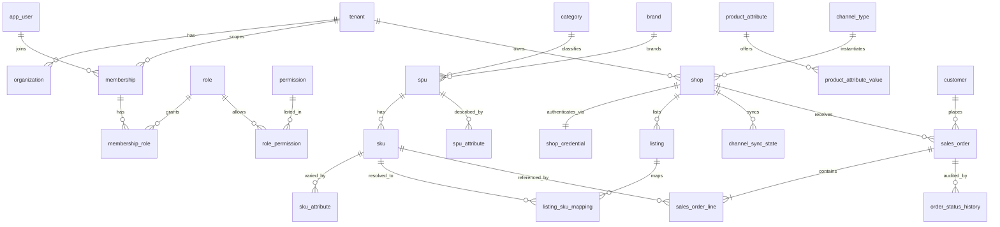
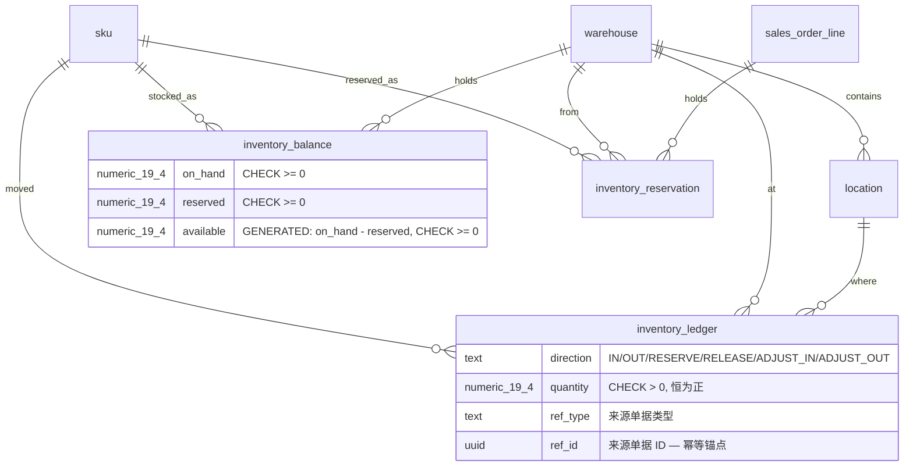
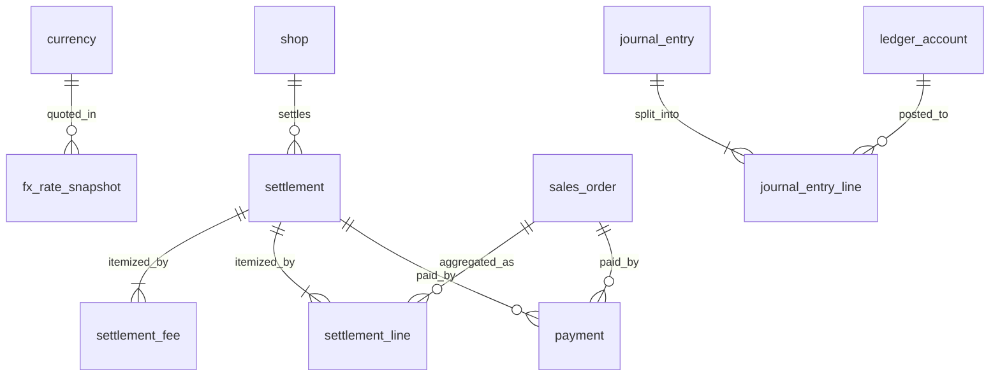

# 核心关系图

只画主干关系。全量 50+ 张表画在一张图上反而看不出依赖方向，所以按**流向**分三张。

## 一、主数据 → 渠道 → 订单（正向引用）

订单行引用的都是**主数据**，反向不引。这保证主数据可以被独立修改而不破坏历史。



**注意 `sales_order_line` 指向 `sku` 的那条线是双向可选的** —— `sku_id` 可空，因为平台可能推来未映射的 `external_sku`。这条线断掉表示「待运营补映射」，不是数据错误。

## 二、库存（自闭合环）

余额、流水、预占三者互相引用，**必须同事务写入**。



`inventory_ledger` 是 append-only 的真相来源，`inventory_balance` 是它的投影。`available` 是**生成列**，不可能与 `on_hand`/`reserved` 漂移。

## 三、财务（账 → 结算 → 总账）



`settlement_line` 携带 `fx_rate` / `fx_rate_as_of` / `base_amount` 的**行内快照**，不实时 JOIN `fx_rate_snapshot`。改汇率表不影响已入账的账。

`journal_entry.source_id` 是**弱引用**（来源跨 5 张表，建不了外键），靠 `source_type` 判别 + 定期巡检 SQL 校验孤儿。

## 依赖方向（为什么这样切）

```
tenancy ──► catalog ──► channel ──► order ──► fulfillment
   │            │            │          │            │
   │            │            │          │            ├──► shipment
   │            │            │          │            │
   └────────────┴────────────┴──────────┴────────────┴──► finance
                                                        │
inventory ◄── order / purchase                          │
   ▲                                                 │
   └────── purchase / aftersales                      │
                                                     ▼
                                          platform（outbox / 幂等 / 审计）
```

依赖**单向**：左边可以引用右边，右边**不引用**左边以外的东西。例外只有两类，都是刻意的：

| 例外                                         | 原因                 |
| -------------------------------------------- | -------------------- |
| `inventory_ledger.created_by → app_user`     | 审计需要知道谁操作的 |
| `order_status_history.changed_by → app_user` | 状态变更审计         |

这两处跨域只引**身份**表，不引任何业务实体，所以不破坏单向性 —— 身份是所有域的公共基础，不是业务域。

## 循环依赖的处理

`order` → `inventory`（预占）和 `inventory` → `order`（`inventory_reservation.ref_id` 指向订单行）看起来是环。实际不是：

- `inventory_reservation.ref_id` 是**弱引用**（配 `ref_type` 判别），不建外键
- 真相在**调用方向**：order 域是事务协调者，它调 inventory 的公开 service，而不是反过来
- 数据库层面不建环，代码层面靠「只有 order 域能编排跨域事务」这条纪律

这是刻意选择弱引用换解耦 —— 代价是失去了外键完整性（孤儿预占行可能残留），收益是订单与库存两个域可以独立演进、各自测试。孤儿预占由 worker 定期巡检清理。
