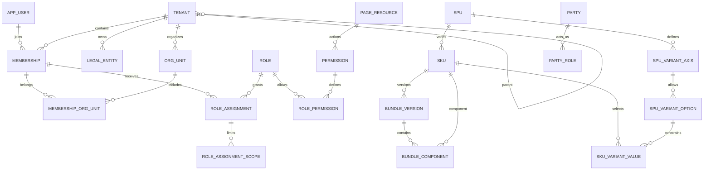

# D1/D2 基础实体字段设计

> 最新属性模型见 [SPU 公共属性与 SKU 完整属性](03-product-flexible-attributes.md)：支持公共固定、公共默认/覆写、SKU 独立值及商品局部自定义。下文旧属性值表和规格值表方案由该文统一替代；规格轴和值仅有一份写入来源。

> 补充设计：[SPU/SKU、子租户与页面 CRUD 权限](02-product-tenant-permissions.md)。商品表明确命名为 spu；子租户、属性扩展与页面权限的细化规则以该文为准。

状态：评审稿，非迁移。[总设计](README.md) 的实体目录覆盖全局；本文将首批身份和商品实体细化到字段/约束。后续服务按阶段同样细化，不直接复制旧 SQL。

## 公共字段与符号

除明确例外，实体均含 `id uuid PK`、`tenant_id uuid NOT NULL`、`created_at/updated_at timestamptz NOT NULL`、`version bigint NOT NULL DEFAULT 0`。可变实体增加 `created_by/updated_by uuid NULL`（全局身份逻辑引用，系统任务可空并另存 actor_type）。数量使用 decimal，名字/编码长度为应用与 DB 共同约束。

下表 `?` 表示可空，未标记即必填。所有租户内编码规范为 trim 后非空、大小写策略固定；一期内部编码统一 ASCII 大写，名称保留 Unicode。被引用实体加 UNIQUE(tenant_id,id)。纯关联表可用复合主键而非强制再造 id。所有 tenant 业务实体逐表 RLS，包括关联表。

## identity 数据库

| 实体                  | 业务字段                                                                                                                                          | 约束与说明                                                                                                                                        |
| --------------------- | ------------------------------------------------------------------------------------------------------------------------------------------------- | ------------------------------------------------------------------------------------------------------------------------------------------------- |
| tenant                | code varchar(64), name varchar(200), status varchar(24), default_timezone varchar(64), parent_tenant_id uuid?, hierarchy_version bigint           | 全局 code 唯一；没有 tenant_id；状态 ACTIVE/SUSPENDED/CLOSED；租户行只向有权成员提供                                                              |
| tenant_closure        | ancestor_tenant_id uuid, descendant_tenant_id uuid, depth int                                                                                     | 控制平面复合主键与树维护规则见补充设计，非普通租户业务表                                                                                          |
| app_user              | display_name varchar(200), status varchar(24)                                                                                                     | 全局身份，无 tenant_id；不提供租户任意列举全局用户的接口                                                                                          |
| external_identity     | user_id uuid, issuer varchar(512), subject varchar(255)                                                                                           | 全局，无 tenant_id；FK user_id→app_user；UNIQUE(issuer,subject)，身份字符串按提供方规范，不大小写归一                                             |
| membership            | user_id uuid, status varchar(24), joined_at timestamptz?                                                                                          | UNIQUE(tenant_id,user_id)，本地 FK user_id→app_user；INVITED/ACTIVE/SUSPENDED/LEFT                                                                |
| invitation            | email_normalized varchar(320), token_hash varchar(128), expires_at timestamptz, accepted_by uuid?, accepted_at timestamptz?, status varchar(24)   | token_hash 唯一，原 token 不存储；接受操作原子消耗，绑定认证身份并检查邮箱证明；日志不输出 email/token                                            |
| legal_entity          | code varchar(64), legal_name varchar(200), registration_country char(2), registration_no varchar(100)?, base_currency char(3), status varchar(24) | UNIQUE(tenant_id,code)；登记号唯一策略按国家另定，不盲设全球唯一；有账后禁止原地换本位币                                                          |
| org_unit              | code varchar(64), name varchar(200), parent_id uuid?, status varchar(24)                                                                          | UNIQUE(tenant_id,code)，复合父 FK；父不能自身；修改层级时锁租户组织树或用等价串行化机制防并发成环                                                 |
| membership_org_unit   | membership_id uuid, org_unit_id uuid, is_primary boolean                                                                                          | PK(tenant_id,membership_id,org_unit_id)；两个本地复合 FK；每成员至多一个 primary（部分唯一索引）                                                  |
| role                  | code varchar(64), name varchar(100), status varchar(24), is_system boolean                                                                        | UNIQUE(tenant_id,code)；系统角色禁止任意修改权限                                                                                                  |
| page_resource         | code varchar(100) PK, parent_code?, name, route_pattern?, status, sort_order                                                                      | 全局页面资源注册表；路由与授权码分离                                                                                                              |
| permission            | code varchar(100) PK, page_code FK, action, description varchar(300), status                                                                      | 全局受控码表；UNIQUE(page_code,action)，如 catalog.sku.update；CRUD 与扩展操作分别授权                                                            |
| role_permission       | role_id uuid, permission_code varchar(100)                                                                                                        | PK(tenant_id,role_id,permission_code)；本地 role 复合 FK、全局 permission FK                                                                      |
| role_assignment       | membership_id uuid, role_id uuid, scope_mode varchar(16)                                                                                          | UNIQUE(tenant_id,membership_id,role_id)；scope_mode=ALL/RESTRICTED；两个本地复合 FK                                                               |
| role_assignment_scope | assignment_id uuid, dimension varchar(24), resource_id uuid                                                                                       | UNIQUE(tenant_id,assignment_id,dimension,resource_id)；dimension=LEGAL_ENTITY/ORG_UNIT/SHOP/WAREHOUSE；前两者本地验证，后两者 owner 授权 API 验证 |

授权计算：一个 assignment 内同维度资源取 OR，出现的不同维度取 AND；多个 assignment 之间取 OR，但操作许可与范围必须由同一个 assignment 同时满足，禁止先合并权限再合并范围。ALL 仅限目标租户，不包括子租户。RESTRICTED 必须至少有一个 scope，空集合拒绝授权，绝不能回退为 ALL。新增维度必须升级授权实现，未知维度默认拒绝。权限数据变更产生版本事件；高风险操作实时核验或使用短期授权缓存与失效机制，不能让长期旧 token 保留被撤销权限。

租户创建流程：认证用户→受限引导操作→生成 tenant UUID→同事务创建 tenant、首个成员与管理员分配。引导账号仅能执行指定路径，不作为业务连接池账号。租户选择先通过身份关联查可访问 membership，再建立事务租户上下文；禁止先信任 header 再查询 membership“证明”它。

## catalog 数据库

| 实体                 | 业务字段                                                                                                                                                             | 约束与说明                                                                                                                                        |
| -------------------- | -------------------------------------------------------------------------------------------------------------------------------------------------------------------- | ------------------------------------------------------------------------------------------------------------------------------------------------- |
| unit_of_measure      | code varchar(32), name varchar(100), dimension varchar(24), quantity_scale smallint                                                                                  | UNIQUE(tenant_id,code)；scale 0..6；COUNT/WEIGHT/LENGTH/VOLUME；单位已用后不可改量纲                                                              |
| brand                | code varchar(64), name varchar(200), status varchar(24)                                                                                                              | UNIQUE(tenant_id,code)                                                                                                                            |
| category             | code varchar(64), name varchar(200), parent_id uuid?, status varchar(24)                                                                                             | 复合自引用 FK，UNIQUE(tenant_id,code)，与部门相同防环                                                                                             |
| spu                  | code varchar(64), name varchar(200), brand_id uuid?, primary_category_id uuid?, status varchar(24)                                                                   | UNIQUE(tenant_id,code)；品牌/分类复合 FK；DRAFT/ACTIVE/INACTIVE/ARCHIVED                                                                          |
| spu_translation      | spu_id uuid, locale varchar(35), name varchar(200), description text?                                                                                                | PK(tenant_id,spu_id,locale)，复合 FK；locale 使用约定的语言标签                                                                                   |
| sku                  | spu_id uuid, code varchar(64), name varchar(200), base_uom_id uuid, kind varchar(24), tracking_mode varchar(24), variant_signature varchar(1000), status varchar(24) | UNIQUE(tenant_id,code)；UNIQUE(tenant_id,spu_id,variant_signature)；kind=STOCKED/VIRTUAL_BUNDLE；tracking=NONE/LOT/SERIAL/LOT_SERIAL；本地复合 FK |
| sku_identifier       | sku_id uuid, scheme varchar(24), value varchar(128), is_primary boolean                                                                                              | UNIQUE(tenant_id,scheme,value)；GTIN 校验长度/check digit 在应用；供应商货号、seller_sku 进入其各自域，不塞此表                                   |
| attribute_definition | code varchar(64), name varchar(100), data_type varchar(24), usage varchar(24)                                                                                        | UNIQUE(tenant_id,code)；变型仅 OPTION 类型、usage=VARIANT；描述属性 usage=DESCRIPTIVE，其类型与值表见补充设计                                     |
| attribute_option     | attribute_id uuid, code varchar(64), label varchar(100), status varchar(24)                                                                                          | UNIQUE(tenant_id,attribute_id,code)；UNIQUE(tenant_id,attribute_id,id)，复合 FK                                                                   |
| spu_variant_axis     | spu_id uuid, attribute_id uuid, position int                                                                                                                         | PK(tenant_id,spu_id,attribute_id)，排序位置同商品唯一                                                                                             |
| spu_variant_option   | spu_id uuid, attribute_id uuid, option_id uuid                                                                                                                       | PK(tenant_id,spu_id,attribute_id,option_id)；FK 到轴以及 attribute_option，保证选项属于该属性                                                     |
| sku_variant_value    | sku_id uuid, spu_id uuid, attribute_id uuid, option_id uuid                                                                                                          | PK(tenant_id,sku_id,attribute_id)；复合 FK 到 sku(tenant,id,spu_id) 和 spu_variant_option；sku 增对应 UNIQUE                                      |

SKU 变型写入在一个事务内完成。`variant_signature` 为按 attribute_id 排序后的 option_id 完整规范字符串（不用有碰撞风险的短 hash），无变型商品用固定空组合；对轴数和串长度设上限。签名由服务根据值生成，客户端不能提交任意签名。激活前校验 SKU 覆盖全部必选轴且无额外轴，应用校验配合唯一约束挡并发重复。商品已有有效 SKU 时变型轴变更需走显式重建流程，不能悄悄改变历史 SKU 的意义。

`VIRTUAL_BUNDLE` 必须 tracking=NONE，不出现在库存余额中；STOCKED 可作为预组装成品，不需要另造一种无法入库的 kind。发生库存后不能直接改追踪方式/基础单位，需受控迁移。跨服务是否已有库存由库存 owner 确认，并通过变更流程阻止竞态，不能“查询一次没库存就随便改”。

## D2 后续启用的商品扩展

这些实体已确定用途，但无需先于简单 SKU CRUD 全部建表。

| 实体                                                  | 最小字段与约束                                                                                                                                                                  |
| ----------------------------------------------------- | ------------------------------------------------------------------------------------------------------------------------------------------------------------------------------- |
| bundle_version                                        | bundle_sku_id, revision int, status, effective_at?；UNIQUE(tenant,bundle_sku_id,revision)，一个生效版本；发布事务锁 bundle，发布后不可变                                        |
| bundle_component                                      | bundle_version_id, component_sku_id, quantity numeric(19,6)；UNIQUE(tenant,bundle_version_id,component_sku_id)，quantity>0；一期只允许 STOCKED 组件，禁止嵌套套装以避免循环展开 |
| sku_uom_conversion                                    | sku_id, from_uom_id, to_uom_id, revision, factor numeric(19,8), status；factor>0，同 SKU/单位对同版本唯一；盒→件是 SKU 箱规，不是全局盒=固定件数                                |
| sku_packaging                                         | sku_id, code, units_per_package, length/width/height_mm, gross_weight_kg；数量与尺寸>0；UNIQUE(tenant,sku_id,code)                                                              |
| party                                                 | code, display_name, party_type, status；UNIQUE(tenant,code)，不是 app_user                                                                                                      |
| party_role                                            | party_id, role_type；PK(tenant,party_id,role_type)                                                                                                                              |
| supplier_profile / customer_profile / carrier_profile | party_id PK within tenant，角色详情单独表，FK 到对应 party_role；一期不做任意扩展字段                                                                                           |
| party_address                                         | party_id, address_type, country_code, region, city, postal_code?, line1, line2?, recipient?, phone?；地址最小必填规则按国家，不强制全球必须州或邮编；敏感字段访问控制           |
| party_contact                                         | party_id, contact_type, encrypted_value, display_mask?；不按跨主体联系方式强制合并                                                                                              |

## 示例：能说明关系才算设计成立

租户 T 有中国采购法人 L1、美国销售法人 L2；用户 U 通过成员 M 同时属于运营部与采购部。商品 P“基础 T 恤”含颜色/尺码两个轴，红色 M 和红色 L 是不同 SKU。两个平台店铺的各自变体都可映射到红色 M；另一个“红色 M 两件装”映射版本含该 SKU 数量 2。

下单购买两件装 3 套：销售行 qty=3；履约组件 qty=6；若从两个仓发，生成多条履约/出库行；库存按各自法人货权与货位扣减。历史订单保留 qty=6 的展开结果，后来改为三件装不会改变旧单。

## 第一批验证清单

- Testcontainers 真实 PostgreSQL 跑每个服务迁移，校验 tenant_id/RLS/运行角色与复合 FK。
- A/B 租户同编码可共存，跨租户品牌/分类/成员关联失败；没有租户上下文不泄露行。
- 全局用户可加入两租户，退出 A 不影响 B；不可伪造 tenant header 或查询其他租户的 scope。
- 成员多部门不产生重复 membership；组织树并发修改不能成环。
- 角色限定“法人 L2 且仓库 W1”不能授权 L1/W1 或 L2/W2；空 RESTRICTED 拒绝。
- SKU 重复规格组合和重复代码并发写入只有一个成功；不同租户不冲突。
- 属性选项与轴不匹配、缺必选轴、虚拟套装直接入库被拒绝。
- 接口契约由后端生成 OpenAPI，生成 TS 产物而非手改。

这里列的是验收要求，当前尚未实现或执行。

## 基础关系图

下图是业务关系，不表示跨服务存在数据库外键。identity 与 catalog 之间只有逻辑租户引用。

