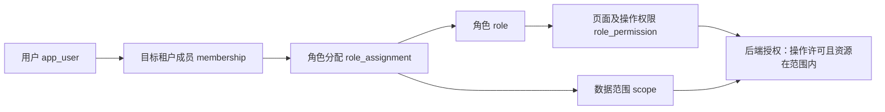

# 商品、子租户与页面权限设计

> 最新属性模型见 [SPU 公共属性与 SKU 完整属性](03-product-flexible-attributes.md)：支持公共固定、公共默认/覆写、SKU 独立值及商品局部自定义。下文旧属性值表和规格值表方案由该文统一替代；规格轴和值仅有一份写入来源。

日期：2026-09-27。状态：评审稿；本轮明确新增子租户及每角色页面 CRUD 配置，尚无迁移或实现。本文补充并细化 [基础字段](01-foundation.md) 与 [总模型](README.md)。

## 1. 商品模型：明确 SPU 与 SKU

之前的 product 实际承担 SPU，但名称不明确，商品属性、资料和生命周期也不够完整。当前统一使用 `spu`，Java 名称 `Spu`；不再另建语义相同的 product 表。

- **SPU**：一种商品款式/型号的共同资料，例如“基础圆领 T 恤”。维护品牌、类目、名称、介绍、通用图片、销售规格定义。
- **SKU**：某一确定规格，例如“基础圆领 T 恤 / 红 / M”。维护唯一内部编码、规格组合、条码、计量单位、追踪方式及实物参数，是库存/采购/履约引用的单位。
- 一个 SPU 有多个 SKU；每个 SKU 必须且只能归属一个 SPU。草稿 SPU 可以暂时没有 SKU，激活至少有一个完整且有效的 SKU。
- 无规格商品仍有一个默认 SKU，其规格签名为空组合。不能让订单直接引用 SPU 替代 SKU。
- SPU 不直接持有库存和单一售价。页面显示的“总库存/价格区间”是按权限、仓库、币种及价目口径计算的摘要。
- SKU 标识商品规格，不标识货主或仓库：同一租户不同法人可拥有同 SKU 的不同库存；不同租户的 SKU 不因编码相同而是同一记录。

示例：SPU `TSHIRT-001`，颜色红/蓝、尺码 M/L，可配置 4 种组合；只生产其中 3 种就只建 3 个 SKU，不自动生成所有笛卡尔积。

| SPU | SKU | 规格 | 例示条码 |
| --- | --- | --- | --- |
| TSHIRT-001 | TSHIRT-RED-M | 红 / M | 单独分配 |
| TSHIRT-001 | TSHIRT-RED-L | 红 / L | 单独分配 |
| TSHIRT-001 | TSHIRT-BLUE-M | 蓝 / M | 单独分配 |

### 商品相关实体及约束

各租户业务表均遵守公共 UUID、tenant_id、复合 FK、审计时间约定。下面只列业务字段；`?` 为可空。

| 表 | 关键字段 | 关系 / 约束 |
| --- | --- | --- |
| spu | code, name, brand_id?, primary_category_id?, description?, status | UNIQUE(tenant_id,code)；基础稿 category_id 统一为 primary_category_id；不得保存 stock 或单一销售 price |
| spu_translation | spu_id, locale, name, description? | UNIQUE(tenant_id,spu_id,locale) |
| spu_category_link | spu_id, category_id | 辅助内部分类，多对多；主分类在 spu 上，不重复作为独立真相；平台类目在 channel |
| sku | spu_id, code, name, base_uom_id, kind, tracking_mode, variant_signature, status | UNIQUE(tenant_id,code)、UNIQUE(tenant_id,spu_id,variant_signature)；spu_id 复合 FK |
| sku_translation | sku_id, locale, display_name | UNIQUE(tenant_id,sku_id,locale)；允许本地化展示规格名，规格身份仍由 option_id 决定 |
| attribute_definition | code, name, data_type, usage, unit_dimension?, status | 类型 TEXT/DECIMAL/BOOLEAN/DATE/OPTION；用途 VARIANT/DESCRIPTIVE；引用后不允许直接改类型或用途 |
| attribute_option | attribute_id, code, label, status | UNIQUE(tenant_id,attribute_id,code)；停用保留历史值 |
| category_attribute_rule | category_id, attribute_id, target_level, required, position | UNIQUE(tenant_id,category_id,attribute_id,target_level)；target=SPU/SKU；一期不隐式继承类目祖先规则，显式配置有效模板 |
| spu_variant_axis | spu_id, attribute_id, position | 一个 SPU 同轴仅一次；只有 VARIANT + OPTION 可作为轴 |
| spu_variant_option | spu_id, attribute_id, option_id | 选项必须来自对应属性且属于 SPU 允许集 |
| sku_variant_value | sku_id, spu_id, attribute_id, option_id | 每 SKU 每轴一个值；同时约束 SKU 所属 SPU 和 SPU 允许选项 |
| spu_attribute_value / sku_attribute_value | owner_id, attribute_id, value_type, text_value?, decimal_value?, boolean_value?, date_value?, option_id?, uom_id? | 每 owner 每属性一个值；CHECK 恰好一个类型值非空；通过(tenant,attribute_id,value_type)复合 FK 固定类型；option 复合 FK 确认归属，应用校验用途与量纲 |
| sku_identifier | sku_id, scheme, value, is_primary | 内部认可标识唯一；GTIN/自有条码与平台 seller_sku 分开；同 SKU/scheme 至多一个 primary |
| sku_physical_spec | sku_id, net_weight_kg?, length_mm?, width_mm?, height_mm? | 每 SKU 一行，正值检查；表示裸品尺寸；销售包装在 sku_packaging，渠道要求校验时再强制齐全 |
| sku_packaging | sku_id, code, units_per_package, dimensions, gross_weight_kg | 单件/内盒/外箱等包装；包装改变运输参数，不自动创造新销售 SKU |
| spu_media / sku_media | spu_id 或 sku_id, file_id, media_type, position, is_primary, alt_text? | 两张明确关联表，业务归 catalog；文件属 support；每主体至多一张主图，读文件先校验商品授权 |
| sku_customs_profile | sku_id, destination_country, origin_country, hs_code, declaration_name, revision, status | HS 编码按目的地而非全球唯一；每 SKU/目的地一个生效版本；报关单冻结当时快照 |
| bundle_version / bundle_component | bundle_sku_id, revision / component_sku_id, quantity | 虚拟组合的销售 SKU 同样归属 SPU；一期只允许库存型组件，发布版本不可改 |

描述属性值表仅服务商品可配置参数，不承载价格、数量、库存状态或所有业务字段。“材质=棉”是 SPU 描述属性，“颜色=红”若用于区分 SKU 就是规格值，两者不复制维护。类目规则变更先标记待完善，不删除已有 SKU；新增必填规则只在新建/编辑/激活校验时执行，历史订单照旧。

### 生命周期及历史稳定性

SPU 与 SKU 各自具有 DRAFT/ACTIVE/INACTIVE/ARCHIVED。SPU 停用会阻止下属 SKU 新业务选用，不删除其库存或历史单据；有效可售条件包含 SPU 与 SKU 都 active。归档前检查业务引用和未完成作业；历史仍可读。

SKU 激活前：完整覆盖 SPU 规格轴、组合唯一、基础单位有效、必填资料齐全；销售和采购可以另有资格配置。激活后规格身份、spu_id、基础单位、追踪模式默认不可原地修改；改规格建新 SKU 并停用旧 SKU。标题、说明、图片等描述可版本更新，订单保留快照。创建组合、规格与签名在同一事务内完成。

“2 件装”有三种不同情况：仅采购箱规→单位/包装换算；销售虚拟两件装→组合 SKU 消耗两个组件；预打包实物→库存型 SKU，组装作业转换库存。不能用一个 quantity_per_pack 同时表达三种事实。

一个渠道变体当前只有一个有效 mapping_version，可映射一个 SKU 或多个组件；多个渠道变体可指向同一内部 SKU。平台标题、ASIN、seller_sku、平台分类属于 channel，不属于 SPU 主键。Listing 映射版本和订单展开快照保持原设计。

## 2. 子租户：层级关系与安全隔离分别建模

采用租户树：集团根租户→子公司/业务运营子租户→下级租户。每个节点是完整的数据隔离单元，可有自己的成员、角色、SPU/SKU、店铺、库存、法人和账簿。部门仍只表达一个租户内部组织，不作为子租户替代品。

**设计默认：父子关系不自动授予业务数据权限。** 父租户管理员管理下级租户生命周期与获得下级业务读写是两个权限。父级用户需要访问某子租户时，在目标子租户有明确成员身份及角色；同一个 app_user 可持有多个 membership，切换目标租户执行操作。此默认等待业务评审，不能把“有子租户”推导成父级可任意读写所有后代。

| 表 | 字段 | 约束 / 用途 |
| --- | --- | --- |
| tenant | parent_tenant_id?, hierarchy_version bigint | 根 parent=NULL；自引用 FK，不能自身为父；代码全局唯一；仍无 tenant_id 列 |
| tenant_closure | ancestor_tenant_id, descendant_tenant_id, depth int | PK(ancestor,descendant)；depth>=0；每节点 self/self/0；两个 FK→tenant；非自关联 depth>0；parent 为事实，closure 为可重建查询索引 |
| tenant_hierarchy_event | id, subject_tenant_id, old_parent_id?, new_parent_id?, actor_user_id, reason, occurred_at | 控制平面审计，树创建/变更留痕；非普通业务表，专用授权访问，无租户数据绕过入口 |
| tenant_catalog_publication | tenant_id(发布方), target_tenant_id, spu_id, publication_version, status | catalog 内发布记录；只能对允许的目标发布脱敏商品版本；目标 ID 为跨服务逻辑引用 |
| catalog_import_mapping | tenant_id(接收方), source_tenant_id, source_spu_id, source_sku_id, local_spu_id, local_sku_id, source_version | 接收方本地复合 FK，来源逻辑引用；UNIQUE(tenant,source_tenant,source_sku_id)；本地 SKU 有独立 ID |

identity 控制平面查询 tenant/closure 必须按当前身份可管理/可进入的节点过滤；不能向任一成员返回全租户树。closure 没有普通 tenant_id 是明确例外，不能给全部服务开放直接查询。创建子租户需 parent 的 tenant.child.create 权限，验证父链有效，串行化更新树与 closure，并在同事务创建子租户首个管理员成员、角色、审计和 outbox。

树结构防环；一期允许多层但限制最大深度 5（配置值，创建时检查）；租户迁移到另一父节点暂不开放普通 CRUD，需要专门迁移流程与权限复核。任何祖先停用时后代有效状态为停用，身份入口和服务授权均校验有效状态/版本，不能只看子节点自身 ACTIVE。

业务表始终 `tenant_id=实际所属节点`，不填根租户 ID，也不在每张业务表加入 root_tenant_id 当替代隔离键。RLS 保持一次事务一个明确目标租户，不用 `tenant_id IN 全部后代` 放宽隔离。

集团汇总查询由 reporting 或服务 API 按当前用户在每个目标租户的角色授权分别查询后合并；报表投影必须保留来源 tenant_id，并在读时重新校验目标权限。不同币种/法人口径不能直接相加。普通跨租户写请求不支持：批量操作拆成每租户单独命令、授权、审计和状态。

### 父子租户共享商品

默认各自独立目录。需要集团统一建品时，父租户显式发布 SPU/SKU 版本，子租户显式导入为本地 SPU/SKU，并保留来源映射。发布载荷排除供应商报价、成本、客户资料等不在授权范围的数据。

第一期同步采用“发现新版本→预览差异→确认更新”，不自动覆盖本地编辑；资料可更新，规格身份变化创建新 SKU；撤销发布停止后续同步，不删除已导入商品和历史订单。库存与订单永远引用本地 SKU；跨租户不建业务 FK。这是建议共享策略，若业务要求集团 SKU 身份全球统一，需要另评共享目录模式，不能偷偷合并租户库存。

## 3. 用户身份、角色、页面 CRUD

用户可以有多个身份：同一登录用户在父租户是集团运营，在子租户 A 是商品管理员，在子租户 B 是只读审计员。关系为：

角色不是 user 表上的单个 role 字符串；角色属于目标租户，用户角色通过 membership 分配，不跨租户引用父级 role。角色模板可复制到子租户，但子租户生成独立 role，模板后续变化不静默增加权限。

### 权限实体

| 实体 | 字段与约束 |
| --- | --- |
| page_resource | code PK, parent_code?, name, route_pattern?, status, sort_order；全局发布码表，page code 稳定，路由变化不改变授权标识；目录节点无业务 CRUD |
| permission | code PK, page_code FK, action, description, status；UNIQUE(page_code,action)；每条是“页面资源 × 操作” |
| role | tenant_id, code, name, description?, status, is_system；租户内 code 唯一；角色停用立即失效 |
| role_permission | tenant_id, role_id, permission_code；唯一；缺记录就是不允许，不额外保存 bool=false 行 |
| role_assignment | tenant_id, membership_id, role_id, scope_mode；角色及成员必须同租户；多角色取满足完整授权条件的 assignment 的并集 |
| role_assignment_scope | assignment_id, dimension, resource_id；原数据范围设计保留，ALL 仅代表本目标租户全范围，绝不包括子租户 |

permission 示例：`catalog.spu.read`、`catalog.spu.create`、`catalog.spu.update`、`catalog.spu.delete`；SKU 页面单独为 `catalog.sku.*`。不沿用过于宽泛的 `.write`。create/update/delete 通常需要同角色 read 才能通过配置校验；没有 read 时页面与列表不显示，直接接口调用也不能绕过。

| 页面资源 | 查看 R | 新增 C | 修改 U | 删除 D | 扩展动作 |
| --- | --- | --- | --- | --- | --- |
| 商品 SPU | spu.read | spu.create | spu.update | spu.delete | spu.import / export / activate / archive |
| 商品 SKU | sku.read | sku.create | sku.update | sku.delete | sku.import / export / activate / archive |
| 销售订单 | order.read | order.create | order.update | order.delete | order.approve / cancel / export |
| 库存查询/作业 | inventory.read | 仅支持的作业创建 | 不直接编辑余额 | 不支持删除流水 | inventory.reserve / release / adjust |
| 角色管理 | role.read | role.create | role.update | role.delete | role.assign / permission.grant |
| 子租户管理 | tenant.child.read | tenant.child.create | tenant.child.update | 不支持直接硬删除 | tenant.child.suspend / close |

表内短码实际带完整域前缀，注册表是唯一事实来源。UI 展示每页权限矩阵（行=页面，列=查/增/改/删/扩展动作），不支持的动作显示禁用而非自动创建 permission。前端页面树与后端资源码可映射，但菜单名、URL、按钮显示都不是后端权限依据。

每个后端用例声明稳定的 permission code，Controller/Service 对命令进行授权，不能简单把所有 POST 当 create（POST 也可能是退款/审批）。同一资源从多个页面进入时仍调用同一规范资源权限；容器页面只聚合可访问组件，不另授予绕过权限的别名。跨服务保存内部事件中的服务身份与必要授权上下文，不能把异步 worker 当无限权限用户。

### 防止组合权限越权

权限和范围必须来自**同一个角色分配**。例如角色 A 有仓库 W1 的调整权限，角色 B 有 W2 的只读权限，不能先合并权限再合并范围得到 W2 的调整权限。

后端判断顺序：身份有效→目标租户及祖先有效→目标成员有效→存在一个有效角色分配同时满足操作和目标数据范围→实体状态允许业务动作。无符合项默认拒绝。D 权限只授权删除可删的草稿/未引用资料，已发生业务的商品应停用/归档；库存和已过账凭证不允许物理删除。授权不能绕过领域不变量。

一期仅 allow 权限，无隐含角色继承或 deny 优先级。租户 Owner 是显式受保护角色：首个 Owner 由创建流程建立，不能删除/停用最后一个有效 Owner；转移 Owner 需专门操作。普通管理员只能授予自己具有且可委派的权限/范围，不能借修改角色扩大已分配成员权限。权限修改与角色分配要检查所有受影响范围并审计；无法证明安全的变更只允许目标租户 Owner 执行。

平台运维管理员不等于租户 Owner；特殊代操作需单独受审计授权流程，不进入普通业务角色模板。权限缓存键含 user/membership、目标 tenant、授权版本；角色、成员、祖先状态变更触发失效。敏感写操作在身份服务核验最新状态，身份服务不可用则拒绝；普通读缓存最大陈旧窗口应在实现前明确并测试，不能宣称事件失效天然即时。

## 4. 示例角色矩阵

以下为建议初始模板，实际可按租户配置，不代表已授予任何账号。

| 角色 | SPU 页面 | SKU 页面 | 订单页面 | 角色管理 |
| --- | --- | --- | --- | --- |
| 商品管理员 | CRUD + 上下架 | CRUD + 上下架 | 无 | 无 |
| 商品编辑 | CRU | CRU | 无 | 无 |
| 订单运营 | R | R | CRU + 取消 | 无 |
| 审计员 | R | R | R | R（成员信息最小化） |
| 租户 Owner | 当前租户已启用能力的管理权限 | 同左 | 同左 | 可管理授权；仍受业务状态约束 |

金额成本、供应商报价、客户敏感资料若同屏显示，需单独字段/资源读取权限及后端响应裁剪，不能仅隐藏前端列。export 单独授权，遵守相同字段和数据范围；导入逐行验证，不能绕过普通 create/update 权限。

## 5. 新增验收要求

- SPU 草稿无 SKU 可存、激活失败；单规格默认 SKU 可用，三个有效组合不自动补第四种。
- 重复 SKU 组合被唯一约束拒绝；描述属性与规格不混用；已使用 SKU 的规格身份修改被拒绝。
- 三层租户创建正确维护 closure；成环、越深、未授权创建/移动失败；祖先停用后子节点不能继续业务写入。
- 父租户 Owner 默认读不到子租户订单；赋予目标成员及 R 角色后可读但不能 U；兄弟租户互不可见。
- 共享商品仅导入授权字段；撤销发布不影响子租户历史订单；来源 SKU 与本地 SKU 不混用。
- 页面 CRUD 矩阵与 API 权限一致，直接请求隐藏按钮对应接口仍被拒绝；修改 URL/header 不能切换未授权租户。
- 双角色不能将 W1 调整权限拼接到 W2；范围为空、未知 permission、停用角色均拒绝。
- 普通管理员不能自授高权限、不能通过修改角色间接提权、不能删除最后 Owner。
- 角色撤销、成员停用、租户祖先停用后按规定失效；缓存/事件断连和身份服务故障纳入测试。

这些均为设计验收标准，尚未执行测试。下一步先评审父级访问默认策略及集团商品共享策略，再生成身份/商品迁移；不需要先创建其他四个服务。
