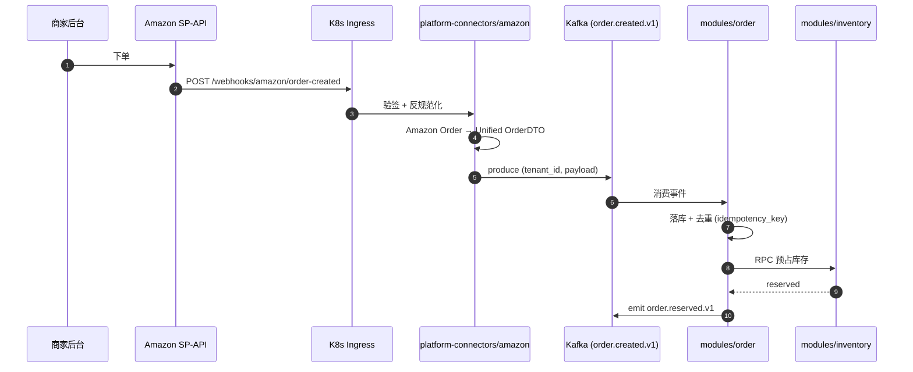
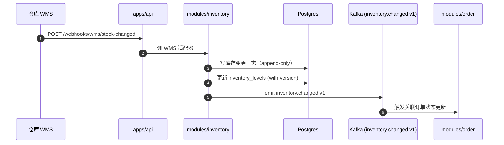
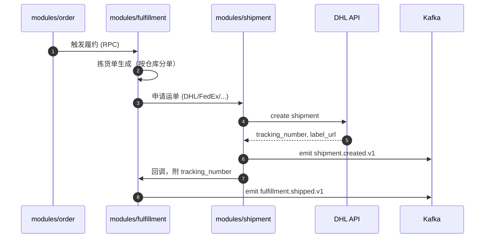
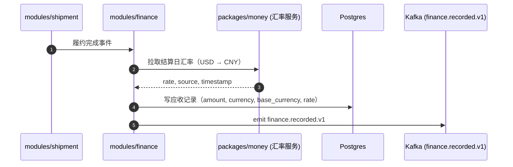
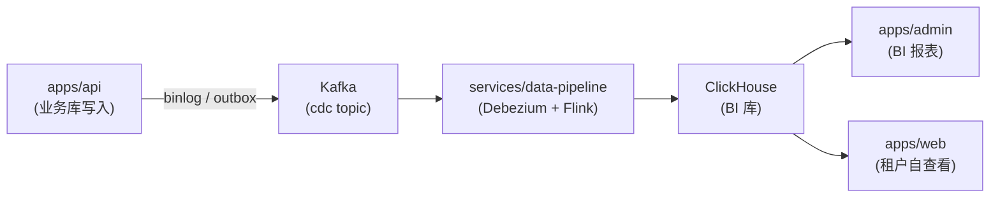

# 关键数据流

> 配套 `overview.md`，逐流画清。本文档随功能上线持续补充。

## 1. 订单接入流（Amazon SP-API 为例）

幂等性：每条消息带 `idempotency_key`（Amazon 原生 order_id），下游表 `UNIQUE(tenant_id, idempotency_key)` 保证不重复消费。

## 2. 库存同步流

乐观锁：每次库存写带 `version`，DB 层 `UPDATE ... WHERE version = $1`，失败重试。

## 3. 履约出库流

## 4. 财务结算流

汇率来源：ECB / 央行公开数据 + 内部加权平均，每日快照存 `fx_rates` 表。

## 5. 跨租户数据汇总流（BI）

为避免 ClickHouse 写入影响业务库，采用 **outbox 模式**：业务写入同事务下写 outbox 表，独立 worker 把 outbox 投递到 Kafka，下游异步消费。