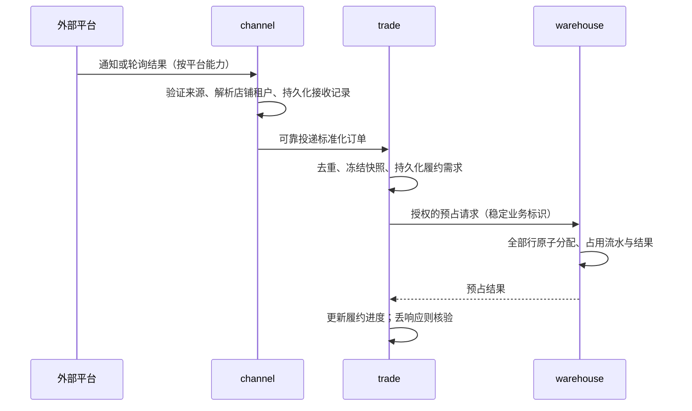

# 关键数据流

> 更新：2026-09-30。本文描述目标设计，不代表平台适配器、消息设施或交易服务已上线。
> 以 [ADR-0004](../decisions/0004-java-spring-boot-microservices.md) 和 [V2 数据设计](../../db/schemas/v2/README.md) 为准。

## 1. 事实归属与传递

channel 负责外部适配与投递，trade 负责订单和履约协调，warehouse 负责数量账和实发事实，finance 负责资金与价值账。各服务独立数据库，只通过授权 API / 事件交换数据，不共享业务表。

业务事实与 outbox 在产生方同一本地事务提交；消费方 inbox 去重与本地业务变更同事务提交。初期可用 relay + 内部 HTTP，不把 Kafka、Flink 或 ClickHouse 作为前置条件。不承诺跨库事务或 exactly-once。

事件去重使用租户、来源和事件标识；订单来源唯一键另外包含平台、店铺与外部订单号。订单号不能充当所有更新事件的去重键，否则后续取消/变更会被误丢。增量事实逐条消费；完整快照才允许按版本淘汰旧值，缺口须补取或对账。

## 2. 订单接入与预占

具体平台接入机制由适配器另行验证，本文不假定存在某个订单 Webhook。租户从已登记店铺关系解析，不信任外部 tenant header。映射缺失进入待映射，不按商品名称猜 SKU。

## 3. 出库、取消与外部回写

warehouse 接受作业后承诺分配，停止普通 TTL 释放；确认实发时，同事务消费预占、扣减在手、记录流水与待发事件。trade 消费实发事实更新已发数量；channel 根据平台能力回传物流。面单创建不等于实发，回传失败不撤销实发。

取消由 trade 协调 warehouse 停止未发货作业并释放对应数量；取消与实发在仓库侧裁决。已发数量转售后，未知结果先查询，不靠再次提交新命令猜测。取消终态阻止迟到预占复活。

外部调用由持久化操作记录驱动，保留业务幂等标识、尝试记录与平台结果。超时进入待核验；若平台不支持查询或幂等且无法确认是否生效，转人工，禁止盲重发。

## 4. 库存回写、退货与价值账

- 可售量由 warehouse 统一计算；channel 消费带版本的完整可售快照并跟踪回写结果。旧快照不得覆盖新快照，回写成功不保证平台库存实时一致，需要定期核对。
- 售后授权由 trade 拥有；warehouse 实收进入待检，再按质检处置。退货入库不隐含退款成功。
- finance 消费出入库、结算及支付事实，按已确认业务政策形成价值记录；发货不是统一收入确认规则，汇率时点也不统一硬编码为结算日。
- 支付/退款未知结果仍保留占用，查证完成或确认未支付且执行终止后才收敛。资金事实由 finance 唯一确认，外部平台退款纳入对账。

## 5. 分析与跨租户汇总

reporting 消费授权范围内的事件构建可重建投影，展示数据截止时间与延迟，不写回业务事实。租户用户查询始终受目标租户授权约束；父级不能自动读全部后代，平台运营身份也不默认获得客户业务明细。

集团汇总需逐目标租户验证显式访问权，并在查询/导出时重新核验；撤权后不可继续从旧投影暴露数据。业务事实与脱敏分析用途分开，原始地址与凭据不得随着通用事件无差别扩散。

## 6. 验收入口

订单、库存、取消、退货的用户流程与故障验收见 [D3–D4 闭环 PRD](../product/prds/order-inventory-fulfillment.md)。技术实现仍需证明本地事务失败无半笔账、重复/乱序/丢响应可恢复，以及真实 PostgreSQL 下的三项租户隔离断言。
