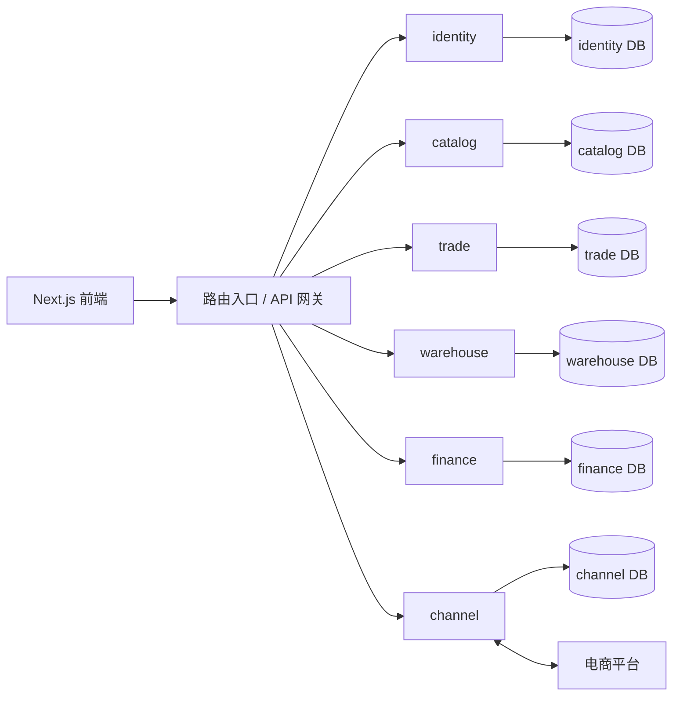

# 系统架构总览

更新：2026-09-27。当前依据：[ADR-0004 Java 微服务](../decisions/0004-java-spring-boot-microservices.md)。identity/catalog 已在本地实现，其余为目标架构。启动、迁移和范围见[本地开发说明](../operations/catalog-local-development.md)。

starcon 是面向跨境电商的多租户 SaaS ERP。前端保持 Next.js/TypeScript，后端采用 Java + Spring Boot 微服务，代码仍在同一 Monorepo。后端 Maven 独立构建，不进入 pnpm/Turbo。

## 业务服务

| 服务      | 责任                                   |
| --------- | -------------------------------------- |
| identity  | 身份、租户、法人、部门、权限           |
| catalog   | 商品、SKU、商业伙伴、价格              |
| channel   | 平台授权、店铺、商品映射与同步         |
| trade     | 销售订单、采购订单、售后及履约流程     |
| warehouse | 库存、预占、实物收发、包裹、调拨、盘点 |
| finance   | 应收应付、收付款、结算对账、成本与总账 |

每个服务独立部署、数据库和账号；初期数据库可在同一 PostgreSQL 集群。跨服务不能 SQL JOIN、建 FK 或直接写表。每库内部采用 tenant_id + RLS。共享库只提供技术能力，不共享领域实体。

图仅表达路由和数据所有权。跨服务通过授权 HTTP API 和可靠事件协作：事件由各服务本地 outbox 提交，经 relay 投递至消费者 inbox；重复、乱序、超时均需可恢复。订单预占/取消流程由 trade 持久化协调；库存账与余额由 warehouse 本地事务维护。

## 技术基线

Java 21、Spring Boot、Maven Wrapper、PostgreSQL 16、jOOQ、Flyway、JUnit 5/AssertJ/Testcontainers、OpenAPI。具体框架版本在骨架阶段验证锁定。Micrometer/OpenTelemetry 采集观测数据。

Redis 仅在缓存/限流需要时引入，不做库存账源。附件采用 S3-compatible 对象存储。消息中间件、分析库、注册中心、配置中心和 service mesh 暂未锁定；不用旧文档中的 Kafka/ClickHouse 示例当成已实施依赖。

## 开发入口

1. [实体目录、业务关系与开发阶段](../../db/schemas/v2/README.md)
2. [身份与商品字段/约束设计](../../db/schemas/v2/01-foundation.md)
3. [多租户原则](../decisions/0002-multi-tenancy-strategy.md)，其中共享 schema 现指每服务内部。

先完成身份隔离和商品主数据，再实现手工订单→库存预占→出库闭环，然后接首个平台与财务。旧 01–09 SQL 草稿未验证，不直接作为 Flyway 迁移执行。

## 子租户与权限补充

[ADR-0005](../decisions/0005-tenant-hierarchy-and-page-rbac.md) 记录子租户与页面 CRUD 设计。每个子租户仍为独立隔离单元，父级访问默认需要目标租户显式授权。商品 SPU/SKU、角色页面权限矩阵及共享目录规则见[专项设计](../../db/schemas/v2/02-product-tenant-permissions.md)。
