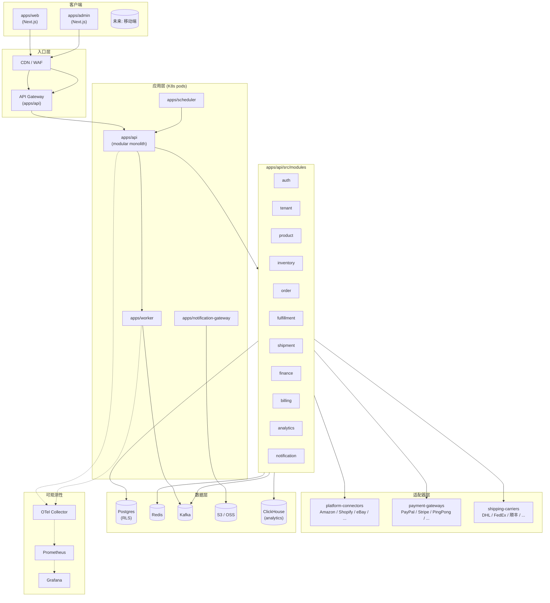
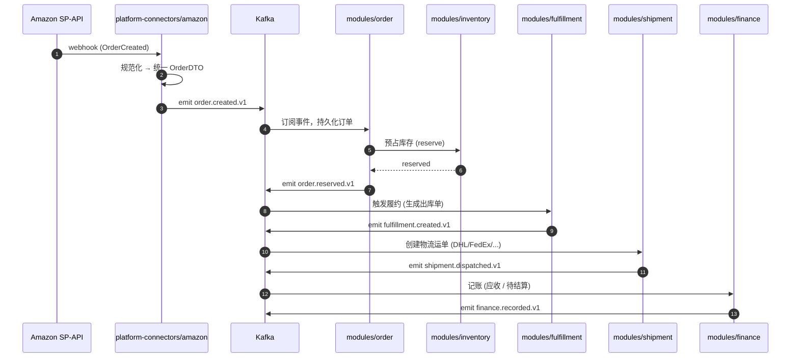

# 系统架构总览

> Status: Living document — 随系统演进持续更新
> Owner: Architecture Team
> Last updated: 2026-09-25

## 一句话

starcon 是一个**多租户 SaaS ERP**，服务跨境电商公司在多个海外平台（Amazon / Shopify / eBay / TikTok Shop / Lazada / 1688 等）上的日常运营，核心闭环：**多平台订单接入 → 库存协同 → 履约调度 → 多币种结算 → 数据洞察**。

## 架构选型摘要

| 维度 | 选型 | 原因 |
|---|---|---|
| 代码组织 | Monorepo (pnpm + Turborepo) | 跨模块共享类型多；多服务同步演进 |
| 后端形态 | Modular Monolith | 早期 SaaS 分布式 = 复杂度爆炸；按领域强隔离，未来再拆 |
| 前端 | Next.js (App Router) + React Server Components | RSC 天然适配 SaaS 列表 + 表单 |
| 数据库 | PostgreSQL（主） + Redis（缓存） + ClickHouse（分析） | 强一致业务 + 高频聚合分析分离 |
| 队列 | Kafka | 跨服务事件流 + 重放能力 |
| 缓存 | Redis | Session / rate limit / 热点库存 |
| 对象存储 | S3-compatible（S3 / MinIO / OSS） | 票据 / 标签 / 截图 |
| 多租户 | Postgres RLS + 租户上下文中间件 | 物理共享、逻辑隔离，性能 / 运维 / 合规平衡 |
| 适配器 | 各三方平台 / 支付 / 物流独立 package，对外统一接口 | 跨境行业三方多且杂 |
| IaC | Terraform + Helm + ArgoCD | 跨云可移植 + GitOps |
| 可观测性 | OpenTelemetry → Prometheus / Grafana / Tempo / Loki | 链路追踪 + 指标 + 日志统一 |

## 系统架构图（mermaid）

## 关键数据流：订单生命周期

## 多租户模型

- **物理共享、逻辑隔离**：所有业务表带 `tenant_id`，DB 启用 RLS
- **租户上下文**：每个请求经 `@starcon/tenancy` 包从 JWT / header 解析 tenant_id，注入 DB session
- **跨租户事件隔离**：Kafka 主题按租户分区 / 加 tenant 标签
- **缓存 key 强制带 tenant 前缀**
- 详见 [`multi-tenancy.md`](multi-tenancy.md)

## 部署拓扑

- **多环境**：dev / staging / prod 三套 K8s 集群
- **GitOps**：ArgoCD 监听 `infra/helm/`，自动同步
- **CI**：GitHub Actions → 单元测试 + lint + typecheck + image build
- **CD**：镜像推镜像仓库 → ArgoCD 检测到版本更新 → 滚动升级
- **金丝雀**：prod 用 Argo Rollouts 做 traffic split

## 已知约束 / 暂未决定

下列待 ADR 确认（详见 [`docs/decisions/`](../decisions/)）：

- 队列: Kafka vs RabbitMQ vs NATS（决策见 `0002-message-queue.md`，待写）
- API 风格: REST + OpenAPI vs tRPC vs GraphQL（决策见 `0003-api-style.md`，待写）
- ORM: Prisma vs Drizzle vs TypeORM（决策见 `0004-orm.md`，待写）
- 后端框架: NestJS vs Hono vs Fastify（决策见 `0005-backend-framework.md`，待写）

## 演进路线

- **Phase 1 (0-12 月)**: Modular Monolith，10 个领域模块全部进 `apps/api/`
- **Phase 2 (12-24 月)**: 拆 `order` `inventory` `fulfillment` 为独立服务（订单量 / 团队规模临界点）
- **Phase 3 (24 月+)**: 拆 `platform-connectors` 为独立 worker 集群；引入专用数据服务